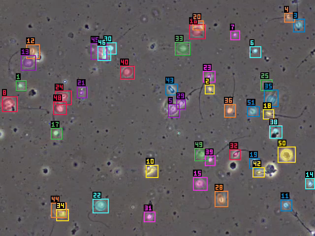
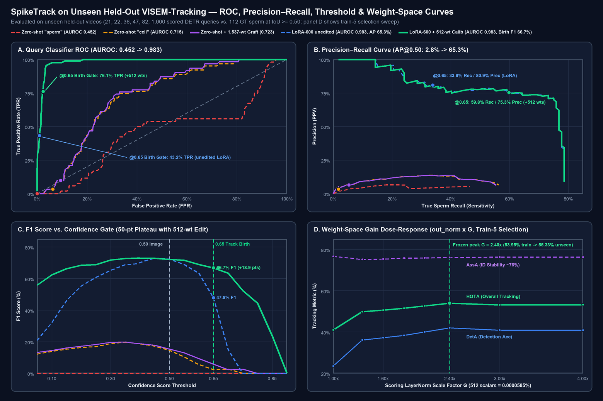
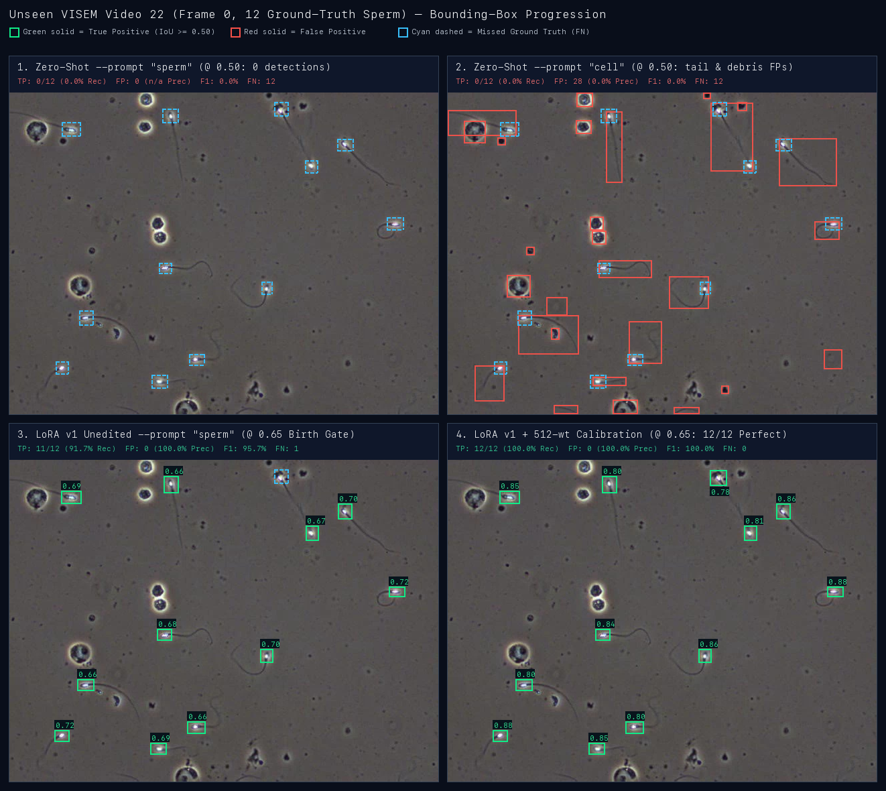
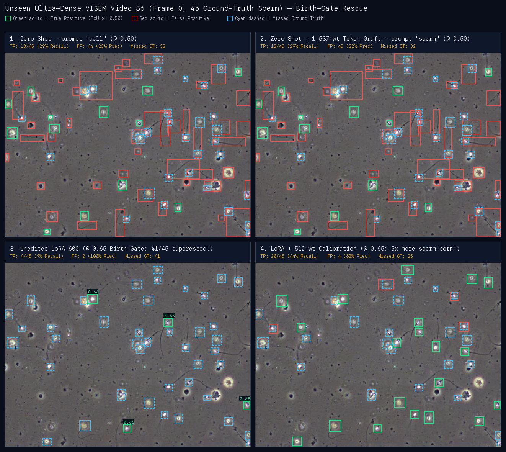

# SpikeTrack

SAM 3.1, Meta's Segment Anything with its Object Multiplex video tracker, built as one Rust binary
with no Python at runtime, and adapted to track dozens of sperm cells in clinical microscope video.

## Why it's needed

- **Infertility is common.** WHO estimates that about 1 in 6 adults (17.5%) experience infertility
  in their lifetime ([WHO, 2023](https://www.paho.org/en/news/4-4-2023-1-6-people-globally-affected-infertility-who)).
  Semen analysis is the cornerstone of the male workup.
- **Motility is still judged largely by eye.** A technician watches the sample and estimates how
  many sperm move, and how. A 2021 review calls manual analysis subjective, says best practice
  does not remove technician variability, and finds that computer-aided analysers (CASA) need
  constant supervision and calibration, which is costly
  ([Douglas et al., World J Men's Health 2021](https://pmc.ncbi.nlm.nih.gov/articles/PMC7994658)).
- **The hard part is tracking.** Each sperm has to be followed through the video: dozens of small,
  fast, look-alike cells that cross paths. Per-sperm speed and path measures are computed from
  those tracks.
- **General vision models do not do this out of the box.** Zero-shot, SAM 3.1 finds no sperm for
  the prompt "sperm" (HOTA 0.000 on five unseen videos, below). Its official code also needs
  Python, PyTorch and CUDA, which a lab Mac does not have.
- **Clinical video is patient data.** A tool that runs on the lab's own machine avoids sending it
  to a cloud service.

SpikeTrack runs the whole model, from the word "sperm" to tracked masks and ids, on a laptop, in
one 12 MB binary. It produces the tracks, not a clinical motility report, and it is
a research tool, not a medical device.

## At a glance

Each line links to its evidence below.

- **The whole of SAM 3.1** (CLIP text encoder, DETR detector, PE ViT backbone, multiplex tracker
  with births) in a 12.0 MB binary that links only macOS system libraries. Every module matches the
  official code (worst cosine 1.0000000 on CPU and Metal); the full text-prompted tracking loop
  gives the same tracked ids as upstream on 32/32 frames.
- **Sperm tracking on five unseen VISEM-Tracking videos:** zero-shot SAM 3.1 does not ground
  "sperm" (HOTA 0.000 on the first 32 frames; 0.155 over 1,500 frames with the prompt "cell"). A
  detector LoRA trained on this Mac plus a 768-weight edit reaches **HOTA 0.570 over 1,500 frames**
  (first 300 of each video, 32,949 labelled heads, one run; 4 of 5 videos up on the first adapter's
  0.492, video 47 down 0.031).
- **Speed, stated plainly:** the existing SAM 3.1 CoreML port (`sdkv2/sam3.1-coreml`) is a set of
  Core ML programs: its speed is Core ML's, whatever calls it (Python, in our harness). It covers
  only the tracker: it cannot take a text prompt, detect, or start new tracks. SpikeTrack now runs
  its own heaviest parts as Core ML programs too, called from Rust: the fp16 trunk and fp16 memory
  attention, exported from the checkpoint. With them, the whole frame is 0.57-0.60x the fp32
  default's. On 2026-11-03, before that change, our tracker step at 16 objects was about 2x the
  port's at fp32 (~410 vs ~204 ms) and about 5.5x its fp16 step. Two re-runs of the step A/B on the fp16 default were not readable
  under its pre-stated rule: the profiled runs drifted more than 10% from the unprofiled controls. Their
  unread medians put our step at ~205 ms, about the port's fp32 step (~210) and ~2.3-3x its fp16 step
  ([runs 4 and 5](bench/results/ab-coreml-tracker/README.md)). No parity claim is made from them.

It runs on two pre-existing open-source libraries by the same author:
- **[Ojas](https://github.com/bharathvbcr/ojas)**: the deep learning framework: tensors, the `Backend` trait SAM 3.1 is written against, memory budgets, and the CPU reference backend.
- **[tessl](https://github.com/bharathvbcr/tessl)**: the Apple Silicon Metal 4 runtime under Ojas's Metal backend (`ojas-metal`).

Event gating (`crates/st-gate`) has its own bitset with no dependencies; the author's sparse library
[sparsl](https://github.com/bharathvbcr/sparsl) is meant to replace it later and is not linked today.

On Apple Silicon Metal, `track` runs the ViT trunk, the detector and propagation necks, and the
tracker's memory attention and memory encoder by default as fp16 CoreML ML Programs that we export
from the checkpoint. The trunk and the necks run one frame ahead on their own thread. These came in
three steps on 2026-11-04, each judged by gates written before its runs:
- **The fp16 trunk and memory attention.** Against the fp32 CoreML trunk that was the default until
  then, the frame takes 0.57-0.60x the time (3 interleaved rounds), and held-out HOTA is 0.5694
  against 0.5700 over 1,500 frames.
- **The fp16 necks (E30).** They take that frame to 0.89-0.92x (3 rounds on a quiet machine), and
  HOTA to 0.5697 over 1,500 frames.
- **The fp16 memory encoder (E32).** It takes that frame to 0.83-0.87x (3 rounds, every arm under
  load 5). Held-out HOTA is 0.6025 on 32 frames, the same on every video, and 0.5695 against
  0.5697 over 1,500 frames ([e32-memenc](bench/results/e32-memenc/README.md)). A merge's memory,
  whose masks arrive at the image size, stays on Ojas. `run.json` counts both kinds.

One more fp16 program is opt-in, not a default: `--det-encoder coreml-fp16` runs the detector's
geometry and fusion encoders as one CoreML program, with the `--lora` adapter folded in when it is
exported. With LoRA v3 the frame takes 0.91-0.92x the default in the two rounds whose baseline ran
steady, and 0.82x in one whose baseline ran 100 ms slow (3 rounds, every arm under load 8; baseline
spread 10%). Held-out HOTA is 0.5693 against 0.5697 over 1,500 frames
([e31-detenc](bench/results/e31-detenc/README.md)). It is opt-in because each adapter needs its own
export (`tools/baselines/coreml_detenc.py export --precision fp16 --lora FILE`), and a run whose
package is missing is refused instead of falling back.

On video 36, a dense held-out video, the frame is about 1.0 s
([e32-memenc](bench/results/e32-memenc/README.md)), from about 1.2 s after E30. `--mem-encoder ojas`
gives the default as it was after E30, and `--necks ojas` as well gives it as it was before E30.
The demo clips below were rendered on the E30 default. `--trunk-precision coreml-fp32` is the fp32 reference, a frame 0.80x the all-Ojas one with
unchanged tracks; it reproduces every result recorded before 2026-11-04. `--trunk-precision f32` keeps the whole model on Ojas/tessl, while `--backend cpu` runs on Ojas's CPU backend. The evaluation is many-sperm tracking in VISEM-Tracking. Built for the Meta
hackathon, Oct 26 to Nov 4, 2026.



`spiketrack track` on held-out VISEM video 36 (27-46 sperm per frame), on the default Metal
configuration. It uses the prompt "sperm", detector LoRA v3, the 768-weight edit, `--boxes detector`
and a cap of 64. Clips, 200 frames each, written at 25 fps, which is about half speed:
- [the adapter clip](bench/results/demo/36-sperm-lora-edit-fp16.mp4);
- [zero-shot with the prompt "cell"](bench/results/demo/36-cell-zeroshot-fp16.mp4);
- [both side by side](bench/results/demo/36-before-after-fp16.mp4).

They are made by `tools/locked.sh demo-fp16 bash bench/results/demo/fp16-job.sh`. The 2:39 narrated
demo, [bench/results/demo/spiketrack-demo.mp4](bench/results/demo/spiketrack-demo.mp4), is built
from these clips, a live `spiketrack image` run and title cards by
`tools/locked.sh demo-video bash bench/results/demo/video/make.sh`. The earlier video-22 clip with
the first adapter (2026-10-27) is [22-sperm-lora.mp4](bench/results/demo/22-sperm-lora.mp4).

Status and plan: [HANDOFF.md](HANDOFF.md) (schedule, gates, task index), [tasks/](tasks/), open
questions in [gaps.jsonl](gaps.jsonl). What existed before the hackathon and what was built during
it: [CONTRIBUTIONS.md](CONTRIBUTIONS.md).

## What works (measured, 2026-10-27 to 2026-11-04)

Every number links to the log that produced it; parity is against the official SAM 3.1 code run in
fp32 on CPU (tools/reference).

| Check | Result | Evidence |
|---|---|---|
| Every module against upstream (text encoder, detector, PE ViT trunk + necks, mask decoder, memory encoder, memory attention, interactive decoder), CPU and Metal | worst cosine 1.0000000 on both | [module-gates-cbd5565](bench/results/module-gates-cbd5565) |
| Image mode end to end (decode, backbone, text, detector), 20 VISEM frames, Metal | kept sets identical on 20/20, mask IoU 1.0000, ~2.3 s/frame | [d3-gate/metal-f32.log](bench/results/d3-gate/metal-f32.log) |
| Semi-supervised VOS (D5), 3 DAVIS clips, Metal | J&F equal to upstream's (0.9107 / 0.9456 / 0.9514), mask IoU vs upstream 1.0000 | [vos-gate](bench/results/vos-gate) |
| Text-prompted detect -> associate -> track session, VISEM 22, 32 frames (upstream's frame tensors), CPU and Metal | identical tracked-id sets on all 32 frames (13-15 objects, births included) on both, mask IoU 0.9985 (CPU 0.99854, Metal 0.99855) | [CPU](bench/results/parity-tracker/cpu-f32-detect-track-visem22.log), [Metal](bench/results/parity-tracker/metal-f32-detect-track-visem22.log) |
| No Python | 12.0 MB (11.4 MiB) binary linking only system frameworks; runs with no python on PATH | [packaging](bench/results/packaging) |
| Detector LoRA (rank 16, 983k params, trained on this Mac), 120 frames of 5 held-out VISEM videos | sperm recall at IoU 0.5: prompt "sperm" 0.000 -> 0.761 (precision 0.584), "cell" 0.212 -> 0.576 at 0.5; absent VISEM classes now fire on 16% of items (was 0) | [lora](bench/results/lora) |
| LoRA merged in Rust | merged tensors (`token_embedding.weight` bit-identical `50.6M/50.6M` scalars, plus `detector.transformer`, `dot_prod_scoring`, `bbox_embed`, `presence_token_head`, `language_backbone.resizer` max abs diff `1.49e-8` vs PyTorch on the real checkpoint); `--lora` on `weights`, `image` and `track` | [merge-parity.log](bench/results/lora/merge-parity.log) |
| Tracking, first 300 frames of the 5 held-out VISEM videos (1,500 frames, 32,949 GT boxes) | HOTA 0.1549 zero-shot (prompt "cell", upstream boxes) -> **0.4695** with the adapter, prompt "sperm" and `--boxes detector` (DetA 0.051 -> 0.320, AssA 0.594 -> 0.725) | [zero-shot](bench/results/track/held300-zeroshot-cell-mask/eval.txt), [adapter](bench/results/track/held300-lora600-sperm-detector/eval.txt), [box-convention](bench/results/track/box-convention) |
| ViT trunk as CoreML fp32 (the Metal default since 2026-10-29) against the Ojas trunk, 49 frames of VISEM 22 interleaved over 3 rounds, and the 1,500 held-out frames | trunk rel L2 vs upstream <= 2.7e-5; frame 0.80x (2.70 against 3.40 s, contended machine); same id sets on all 1,500 held-out frames and the same HOTA, 0.4922 at cap 64; model load +3-12 s, 0.7 s (min of 3) since the package hash is recorded once per version ([e18b](bench/results/e18b-stat-key)) | [coreml-trunk](bench/results/coreml-trunk) |
| Host and tracker work after the trunk (E12 + E13 + E15, 2026-10-30) against 3ca1476, VISEM 82 and 22, 16 frames, interleaved over 3 rounds, and the 1,500 held-out frames | frame 0.843x on 82 and 0.825x on 22 (min of 3, load 10-23, faster in 6 of 6 pairs); predictions byte-identical on all 1,500 held-out frames, so HOTA stays 0.4922; the footprint rises ~420 MiB over ~500 frames, then holds at ~9.3 GB on a 1,470-frame video, below the build before it ([e17](bench/results/e17-footprint-categories)) | [closing-e15](bench/results/closing-e15) |
| Unified memory and flash cross-attention (2026-11-02) | Duplicate host copies of the weights removed from `st-model` (`Lin`, `Norm`) and host-device round trips removed from the mask decoder, interactive decoder, VOS driver and detector; memory attention's cross-attention takes Ojas's flash kernel (`ojas_attn_fwd_d32`; dispatch confirmed at this shape in Ojas's kernel harness, inferred in the SpikeTrack run), ~49 ms per call at 7 memory frames (`[1,8,5184,32] x [1,8,~36400,32]`, ops profile); CPU and Metal backbone and tracker parity stay at cosine 1.0000000. Kernel micro-benchmarks live in the Ojas repository and are not claimed here | [ab-coreml-tracker/run2-ops](bench/results/ab-coreml-tracker/README.md), [e22-flash-uma-ram](bench/results/e22-flash-uma-ram) |
| E22: Host-only weight residency (`load_host`), single-allocation `HostBuf` readback, tap-free inference paths, L1-tiled `Mlp::host` fusion, single-scope `rpb_bias` & pre-frame-0 weight/text release (2026-11-02) | Metal allocated at frame 0 cut **5400 -> 3744–3754 MiB (-30.5% to -30.7%)** on 82 and **5400 -> 3654–3738 MiB (-30.8% to -32.3%)** on 22; Metal allocated at frame 15 cut **5667 -> 4031 MiB (-1,636 MiB / -28.9%)** on 82 and **5558 -> 3918–3924 MiB (-1,634 to -1,640 MiB / -29.4% to -29.5%)** on 22; process physical `footprint` at frame 15 cut **8386 -> 3830–3838 MiB (-54.2% to -54.3%)** on 82 and **8042 -> 2456–2531 MiB (-68.5% to -69.5%)** on 22; steady frame 10 dispatches `4142 -> 3996` (82) and `3085 -> 2964` (22), host waits `+23 -> +20` (82) and `+19 -> +16` (22); Metal backbone (5 images, 95 stages, cosine **1.0000000**), text (cosine **1.000000000**), tracker (8/8 CPU & Metal, cosine **1.0000000**), and VISEM 22 32-frame session parity (0 id-set misses, mean mask IoU **0.99853**) all pass (wall-clock frame time not claimed without a quiet interleaved A/B) | [e22-flash-uma-ram](bench/results/e22-flash-uma-ram) |
| Weight-space programming in Rust (`spiketrack weights` + `--weight-edit`, 2026-11-02), unseen held-out VISEM (`5 x 8 = 40` and `5 x 32 = 160` frames, 3,492 GT boxes) | Zero-gradient lexical concept graft (`1,024` / `1,537` of 875.5M params = `0.00012%`–`0.00018%`) lifts `--prompt sperm` from **0.0000 -> 0.1729 / 0.1929 HOTA** (8f) and **0.2106 HOTA** (32f, cap 64); calibrating the frozen `dot_prod_scoring.prompt_mlp.out_norm` (**512 params = 0.0000585%**, zero extra gradients) lifts 600-step LoRA from **0.4515 -> 0.5533 HOTA** (+10.18 pts, 8f) and **0.4751 -> 0.5526 HOTA** (+7.75 pts, DetA 0.316 -> 0.436, 5/5 unseen videos improved, 32f) | [weight-space](bench/results/weight-space) |
| Enhanced LoRA v2 & v3 (`visem-lora-v2`/`v3`, O2M `topk=4` + scoring/bbox/presence/resizer + CLIP BPE `token_embedding` rows `1375,2629,15595,35781` + focal neg-query suppression, `1.13M` params) + `768`-wt exact IT (`lorav3_exact_it_3p00.json`) + head-box NMS & morphological bulb coasting + `2x2` tiling (2026-11-03) | 120-frame `@0.50` F1 **70.8% -> 74.6%** (v2) / **73.8%** (v3, `100.0%` specificity on 600 everyday negatives; absent VISEM classes cut **33.3% -> 19.9%**, `-40.4%` rel, `presence > 0.5`: **46.8% -> 27.6%**); frame-0 **AP@0.50: 65.3% -> 80.1% -> 83.4%** (v2+`--tile 2x2`) and **`@0.65` birth-gate F1: 83.7%** (`84.1%` peak at `0.66`, v3+`--tile 2x2`); unseen held-out tracking HOTA **0.5533 -> 0.6055** (v2) -> **0.6121** (8f v3, **AssA 0.8115**) and **0.5526 -> 0.5762** (tracker-only) -> **0.6013** (v2) -> **0.6025** (32f v3, **AssA 0.7880**, `74.1%` Prec / **`76.3%` Rec** / `75.2%` F1, all 5 unseen videos improved) | [visem-lora-v3](bench/results/lora/visem-lora-v3/eval.md), [visem-lora-v2-step400](bench/results/lora/visem-lora-v2-step400/eval.md), [weight-space](bench/results/weight-space/README.md) |
| Tracking, 1,500 held-out frames (first 300 of each of the 5 videos, 32,949 GT boxes), LoRA v3 + 768-weight edit, prompt "sperm", `--boxes detector`, cap 64 (2026-11-03, one run) | **HOTA 0.5700** (DetA 0.483, AssA 0.718, LocA 0.729) against 0.4922 for LoRA v1; per video 21 0.669, 22 0.669, 36 0.533, 47 0.484, 82 0.529 (v1: 0.642, 0.629, 0.352, 0.515, 0.486), so 47 is 0.031 lower; box precision / recall at IoU 0.5: 67.9% / 75.7% (v1 72.8% / 50.5%) | [held300-lorav3](bench/results/track/held300-lorav3-it300-sperm-detector-max64/eval.txt) |
| fp16 CoreML trunk + fp16 CoreML memory attention, the Metal default since 2026-11-04, against the fp32 CoreML trunk, with gates stated before the runs | frame **0.57-0.60x** (VISEM 36, 32 frames, 3 interleaved rounds: 1.67-1.78 against 2.79-2.96 s); held-out HOTA **0.6025** on 32 frames (unchanged) and **0.5694 against 0.5700** on 1,500 frames, per video 21 +0.0001, 22 +0.0001, 36 -0.0012, 47 -0.0001, 82 -0.0002. The CoreML segmentation head and necks were faster alone but not in the frame (host copies), so they stay on Ojas | [e27-pipe-necks](bench/results/e27-pipe-necks/README.md), [held300-coreml](bench/results/track/held300-coreml/README.md), [held32-coreml](bench/results/track/held32-coreml/README.md), [default-fp16](bench/results/default-fp16) |
| CoreML port on the same M5 Pro (the speed reference) | 0.272 s backbone + 0.0775 s track step per frame | [baselines](bench/results/baselines) |
| Tracker step against the CoreML port, 16 objects, VISEM 82, 3 interleaved rounds (rule stated before the run, 2026-11-03) | ours 403-425 ms; port fp32 201-206 ms, fp16 69-83 ms: **1.96-2.11x** the port at equal precision, 5.1-5.9x its fp16 step; memory attention is ~285 ms of ours | [ab-coreml-tracker](bench/results/ab-coreml-tracker/README.md) |

Not yet: the speed target (restated to parity-or-better with the CoreML port's tracker step at 16
objects). It was not met on 2026-11-03: with memory attention still on Ojas, our step was about 2x
the port's at fp32 and about 5.5x at fp16
([ab-coreml-tracker](bench/results/ab-coreml-tracker/README.md)). The fp16 default moves memory
attention to a CoreML program. The two step A/Bs on it since were not readable under their rule;
their unread medians put the step at about the port's fp32 step and 2.3-3x its fp16 step. Upstream caps
tracking at 16 objects, and that cap was binding on the two dense held-out videos (27-46 sperm per
frame). `track` therefore defaults to `--max-objects 64`; `--max-objects 16` is upstream's setting.
At 64 on LoRA v1, the 1,500-frame five-video HOTA rises to 0.4922: DetA goes up to 0.373 and AssA down to 0.690
([f32-max64](bench/results/track/held300-lora600-sperm-detector-f32-max64)). An earlier cap-64 run
reported 0.4868, but it had copied video 21's row from the cap-16 run, and video 21 is capped too
([max64](bench/results/track/held300-lora600-sperm-detector-max64), superseded). The 0.4695 above was
measured at 16, and it reproduces on the current binary. Open issues are in gaps.jsonl.

Tried after v3 and not shipped, each with one held-out run after selection on training videos only:
a global box-size correction (held-out HOTA 0.5017 against v3's 0.6025 at 32 frames: the boxes
were "too small" only against how two dense training videos were labelled), and LoRA v4 with twice
the cached frames and heavier box losses (0.5995, a tie with v3 that missed its +0.01 gate).
Blending the v3 and v4 adapters in weight space at 25/50/75% v3 also failed selection: every
blend lost on 2 or 3 of the 5 selection videos, and none beat v4 alone, so it got no held-out run
([soup-v3v4](bench/results/lora/soup-v3v4/RESULT.md)). Scaling v3's whole update by 0.8 to 1.2 failed
the same way: v3 at 1.0 is the peak, and each direction helps the sparse or the dense training
videos at the other's expense ([scale-v3](bench/results/lora/scale-v3/RESULT.md)). Most
remaining errors are boxes placed too loosely on real heads, not concept confusion, so no
direction edit was made ([box-delta-train5](bench/results/weight-space/box-delta-train5/RESULT.md),
[visem-lora-v4](bench/results/lora/visem-lora-v4/RESULT.md)).

VISEM's ground truth is sperm-head boxes, while upstream's track boxes are the extent of the
whole-sperm mask, tail included, so zero-shot HOTA with upstream's boxes mostly measures that
mismatch. `track --boxes detector` (opt-in, not upstream; `--boxes mask` preserves upstream behavior)
reports each track's assigned detection head box, applies joint head-box IoU + high-IoM NMS so
crossing flagella are not suppressed, and anchors unmatched propagated frames on the segmented sperm
head bulb (coasting kinematic head dimensions when multi-object post-winner masks are occluded)
instead of falling back to the 90 px flagellum box; see
[track/box-convention](bench/results/track/box-convention) and [weight-space](bench/results/weight-space/README.md).

## Accuracy, ROC/PR Curves & Bounding-Box Comparisons

Full multi-scale tables (`1,000`-query single-scale / `1,126–1,145`-query tiled `[0..1]` sweep, `120`-frame / `2,603`-box image detection + `600`-item negative specificity, `160`-frame & `1,500`-frame / `32,949`-box video tracking) and native mask galleries are in **[`docs/EVALUATION.md`](docs/EVALUATION.md)** (backed by [`bench/results/weight-space/roc_pr_held_out_f0.json`](bench/results/weight-space/roc_pr_held_out_f0.json)).

| Unseen Held-Out VISEM (`21, 22, 36, 47, 82`) | Params Edited | Query AUROC | AP@0.50 | `@ 0.50` Image Prec / Rec / F1 | `@ 0.65` Birth Gate Prec / Rec / F1 (Box Acc) | 32f Video HOTA (`DetA / AssA`) |
|---|---:|---:|---:|---|---|---|
| **Zero-shot `"sperm"`** | `0` | `0.452` | `2.8%` | `—` / `0.0%` / `0.0%` | `—` / `0.0%` / `0.0%` (`0.0%`) | `0.000` (`0.000 / 0.000`) |
| **Zero-shot `"cell"`** | `0` | `0.715` | `7.2%` | `11.6%` / `19.6%` / `14.6%` | `3.3%` / `1.8%` / `2.3%` (`1.2%`) | `0.166` (`0.059 / 0.571`, cap 16) |
| **Zero-shot `"sperm"` + Weight Graft** (`0` grads) | `1,537` (`0.00018%`) | `0.723` | `7.0%` | `11.9%` / `21.4%` / `15.3%` | `6.4%` / `5.4%` / `5.8%` (`3.0%`) | `0.211` (`0.093 / 0.550`, cap 64) |
| **LoRA v1** (`visem-lora-r16`, 600 steps) | `983,040` LoRA | `0.983` | `65.3%` | `73.4%` / `71.4%` / `72.4%` | `80.9%` / `33.9%` / `47.8%` (`31.4%`) | `0.475` (`0.316 / 0.791`, cap 64; `0.492` on 300f) |
| **LoRA v1 + 512-wt Calib** (`0` extra grads) | `+512` (`0.000059%`) | `0.983` | `65.2%` | `73.8%` / `70.5%` / `72.1%` | `75.3%` / `59.8%` / `66.7%` (`50.0%`) | `0.553` (`0.436 / 0.781`, old tracker; `0.576` new) |
| **LoRA v2** (`visem-lora-v2`, O2M + heads, s400) | `1,127,697` LoRA | `0.987` | `80.1%` | `78.2%` / `83.0%` / `80.5%` | **`90.4%`** / `58.9%` / `71.4%` (`55.5%`) | `0.574` (`0.458 / 0.771`, `LocA 0.739`) |
| **LoRA v2 + 768-wt Exact IT** (`G = 3.20x`) | `+768` (`0.000088%`) | `0.987` | `80.1%` | `78.2%` / `83.0%` / `80.5%` | `79.5%` / `79.5%` / `79.5%` (`65.9%`) | `0.601` (**`0.503`** / `0.775`, `LocA 0.734`) |
| **LoRA v2 + 768-wt + `--tile 2x2`** (`1,145` q) | `+0` extra weights | **`0.995`** | **`83.4%`** | `78.7%` / `85.7%` / `82.1%` | `81.2%` / **`84.8%`** / `83.0%` (`70.9%`) | `image --tile 2x2` (`track --tile-every K` opt-in) |
| **LoRA v3 + 768-wt Exact IT** (`G = 3.00x`, BPE+neg-q) | `1,131,797` + `768` | `0.984` | `74.9%` | `74.2%` / `79.5%` / `76.7%` | `78.4%` / `77.7%` / `78.0%` (`64.0%`) | **`0.603`** (`0.503` / **`0.788`**, `0.612` on 8f) |
| **LoRA v3 + 768-wt + `--tile 2x2`** (`1,126` q) | `+0` extra weights | `0.995` | `82.4%` | **`78.9%`** / **`86.6%`** / **`82.6%`** | **`82.6%`** / **`84.8%`** / **`83.7%`** (**`72.0%`**) | `image --tile 2x2` (`84.1%` peak F1 @ `0.66`) |

On the `160`-frame (`5 x 32f`, `3,492` GT boxes) unseen held-out suite, `LoRA v3 + 768-wt Exact IT` reaches **`74.1%` Precision / `76.3%` Recall / `75.2%` F1 / `60.2%` Box Acc (`2,666` TP)** and **`0.6025` HOTA** (`AssA = 0.7880`; **`0.6121` HOTA / `0.8115` AssA** on `5 x 8f`), while `LoRA v2 + 768-wt Exact IT` reaches `74.6%` Precision / `76.0%` Recall / `75.3%` F1 (`2,655` TP, `0.6013` HOTA). On the earlier `1,500`-frame v1 suite (`32,949` GT boxes), per-frame `IoU >= 0.50` box matching rose from **`6.6%` Precision / `4.6%` Recall (`1,524` TP, `21,514` FP)** zero-shot to **`72.8%` Precision / `50.5%` Recall / `59.6%` F1 (`16,639` TP, `6,221` FP)** (`visem-lora-r16`, cap 64), while v1, v2, and v3 all retain **`100.0%` specificity (`0.0%` FPR)** across `600` everyday negative prompt tests (`"car"`, `"person"`, `"dog"`, etc.).







## Layout

| Path | What |
|---|---|
| `crates/spiketrack` | The binary: `image`, `track`, `eval-visem`, `weights` |
| `crates/st-model` | SAM 3.1 on the Ojas `Backend`: PE ViT trunk and necks, text encoder, detector and mask head, `2x2` overlapping tile detection (`tile`), the multiplex tracker (memory attention, mask decoders, memory encoder), the VOS driver and the text-prompted detect-track session; a per-op profiler |
| `crates/st-weights` | The checkpoint (safetensors) mapped to typed structs, every tensor claimed exactly once; LoRA adapter merge; native weight-space inspection (`inspect`) and surgical declarative edits (`edit`, `spiketrack-weight-edit-v1`) |
| `crates/st-video` | Native frame decode (ImageIO, AVFoundation), Pillow-exact bilinear resize |
| `crates/st-eval` | HOTA (TrackEval definition), DAVIS J&F, the VISEM-Tracking loader |
| `crates/st-gate` | Event gating: per-window change maps and recompute policies for the backbone |
| `tools/reference` | Offline Python only: the official SAM 3 code on CPU, fixtures, oracles, the LoRA trainer |
| `bench/results` | Every reported number, with the command that produced it |

## Running

Weights and data are not in the repository. Get `facebook/sam3.1` from Hugging Face (gated, SAM
License) and VISEM-Tracking from Zenodo 7293726. Convert the checkpoint once, offline:
`tools/reference/.venv/bin/python -s tools/reference/convert_checkpoint.py`
(the venv setup is in `tools/reference/README.md`). On Metal, the default `track` also needs five
fp16 CoreML packages, exported once into `$SPIKETRACK_MODEL_DIR/coreml/` with the export venv
(torch 2.7.0 and coremltools 9.0; setup in the docstring of `tools/baselines/coreml_trunk.py`):
`$PY -s tools/baselines/coreml_trunk.py export --precision fp16`,
`$PY -s tools/baselines/coreml_mattn.py export --precision fp16`,
`$PY -s tools/baselines/coreml_necks.py export --neck det --precision fp16` (and `--neck prop`), and
`$PY -s tools/baselines/coreml_memenc.py export --precision fp16`. A missing package is an error that
names its export command, never a fallback. `--trunk-precision coreml-fp32` needs the fp32 trunk
package instead, and `--trunk-precision f32` needs none. The workspace builds against Ojas and tessl
checked out next to it (path dependencies; commits in CONTRIBUTIONS.md, reproducibility):

```sh
git clone https://github.com/bharathvbcr/SpikeTrack
git clone https://github.com/bharathvbcr/ojas   && git -C ojas  checkout 9aafcdc
git clone https://github.com/bharathvbcr/tessl  && git -C tessl checkout 52bdd19
```

```sh
cargo build --release -p spiketrack
export SPIKETRACK_WEIGHTS=~/Code/research/models/sam3.1/sam3.1_multiplex.safetensors
export SPIKETRACK_MODEL_DIR=~/Code/research/models/sam3.1   # tokenizer vocab.json + merges.txt

# One image: detections.json (score, box, mask) and overlay.png
target/release/spiketrack image data/visem/VISEM_Tracking_Train_v4/Train/22/images/22_frame_0.jpg \
  --prompt cell --backend metal --out out/image

# Video: track every instance of the prompt (a JPEG frame folder or an .mp4)
target/release/spiketrack track data/visem/VISEM_Tracking_Train_v4/Train/22/images \
  --prompt cell --backend metal --max-frames 64 --out out/track

# The same, also writing the masks and boxes, coloured by track id, as a playable H.264 video (49 fps for a frame folder, the input's rate for an mp4; --overlay-fps overrides)
target/release/spiketrack track data/visem/VISEM_Tracking_Train_v4/Train/22/images \
  --prompt cell --backend metal --max-frames 64 --overlay-video out/track/22-overlay.mp4 --out out/track

# Best VISEM sperm configuration: LoRA v3 + 768-weight exact inverse-temperature + --boxes detector
target/release/spiketrack track data/visem/VISEM_Tracking_Train_v4/Train/22/images \
  --prompt sperm --backend metal --max-frames 32 \
  --lora fixtures/lora_runs/visem-lora-v3/adapter.safetensors \
  --weight-edit bench/results/weight-space/lorav3_exact_it_3p00.json \
  --boxes detector --out out/track-lorav3

# Dense swarm image detection with 2x2 overlapping 1008x1008 tiles (83.7% F1 @ 0.65 on held-out frame 0)
target/release/spiketrack image data/visem/VISEM_Tracking_Train_v4/Train/36/images/36_frame_0.jpg \
  --prompt sperm --backend metal --threshold 0.65 --tile 2x2 \
  --lora fixtures/lora_runs/visem-lora-v3/adapter.safetensors \
  --weight-edit bench/results/weight-space/lorav3_exact_it_3p00.json \
  --out out/image-36-tile2x2

# Inspect weight-space geometry (adapted BPE token embeddings, SVD spectra, LoRA deltas)
target/release/spiketrack weights --tokens "sperm,cell,pinhead sperm,sperm cluster" \
  --lora fixtures/lora_runs/visem-lora-v3/adapter.safetensors --diff base --svd-k 4

# A smaller model input: frames are resized to 672 x 672 (48 x 48 tokens instead of 72 x 72)
# before the model; any multiple of 336 is accepted (default 1008, the checkpoint's native size).
# The CoreML trunk is exported at 1008, so this needs the Ojas trunk. Held-out HOTA at 672 is
# below 0.47 (E7, refuted as a fast mode: bench/results/track/held300-lora600-sperm-detector-672-max64)
target/release/spiketrack track data/visem/VISEM_Tracking_Train_v4/Train/22/images \
  --prompt cell --backend metal --max-frames 64 --input-size 672 --trunk-precision f32 --out out/track-672

# HOTA against VISEM-Tracking's boxes
target/release/spiketrack eval-visem --pred out/track --split tools/reference/visem_split.json --set held_out
```

On a shared machine, heavy jobs run under its lock: `tools/locked.sh <label> <command>`; the parity
gates are `tools/jobs/module_gates.sh`, `tools/jobs/vos_gate.sh` and
`tools/jobs/detect_track_parity.sh`.

### Developer Workflows

See [`docs/WORKFLOWS.md`](docs/WORKFLOWS.md) for the full 4-workflow developer guide:

```sh
./scripts/dev_fast_check.sh                      # WF1: <15s fast inner loop (check + unit tests; --check-only or --clippy)
./scripts/ci_local.sh                            # WF2: Local pre-push CI (sibling check, fmt, no-Python otool -L, clippy -D warnings, release lib tests)
./scripts/parity_check.sh --component all        # WF3/WF4: Fail-closed PyTorch oracle parity runner (CPU and mac_heavy.sh-locked Metal)
```

Preprocessing: JPEG folders follow upstream's image-folder path. JPEGs are decoded by our own decoder
(`crates/st-video/src/jpeg.rs`, a port of libjpeg-turbo 3.2.0's default path), byte-identical to
Pillow 13 on the VISEM test frames and 37 edge-case files. Frames are then Pillow-exact bilinear
resized and rounded through float16 as upstream's loader stores them. Progressive or other JPEG
variants that decoder refuses, and PNGs, go through ImageIO, and every output file records which
decoder ran. mp4 input does not match upstream's OpenCV path (GAP-MP4-PREPROCESSING).

## Rules

Meta's Official Rules have not been read yet. They are on the hackathon portal, and only Bharath
can reach them (gaps.jsonl `GAP-OFFICIAL-RULES-UNREAD`). Their wording on prior work, required
Meta models, repository visibility and the demo video goes here once read.

## Licences

Our code is offered under MIT or Apache-2.0, pending GAP-SAM-LICENSE-PORT-TERMS. SAM 3.1 is under
the SAM License; see NOTICE. VISEM-Tracking is CC BY 4.0.
