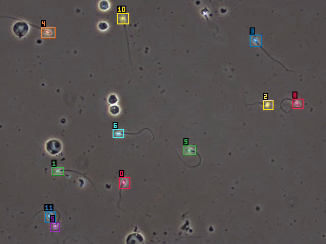

# SpikeTrack

SAM 3.1, Meta's Segment Anything with its Object Multiplex video tracker, built as one Rust binary
with no Python at runtime. It executes within a **3-tier modular compute ecosystem**:
- **[Ojas](https://github.com/bharathvbcr/ojas)**: Central universal deep learning framework providing tensor representations, autograd Tape, memory budgeting, and the CPU reference backend.
- **[tessl](https://github.com/bharathvbcr/tessl)**: Dedicated Apple Silicon / Metal 4 acceleration extension and Mac inference engine powering Ojas's Metal backend (`ojas-metal`).
- **[sparsl](https://github.com/bharathvbcr/sparsl)**: Dedicated Sparse Computing extension providing deterministic SpMV, CSR/CSC indexing, and sparse change maps for event gating (`crates/st-gate`).

On Apple Silicon Metal, `track` runs the ViT trunk by default as a CoreML ML Program that we
export from the checkpoint (`--trunk-precision coreml-fp32`). That makes the frame 0.80x and leaves
the tracks unchanged. `--trunk-precision f32` keeps the whole model on Ojas/tessl, while `--backend cpu` runs on Ojas's CPU backend. The evaluation is many-sperm tracking in VISEM-Tracking. Built for the Meta
hackathon, Oct 26 to Nov 4, 2026.



`spiketrack track` on held-out VISEM video 22 with the prompt "sperm", the detector LoRA and
`--boxes detector`. The clip is [bench/results/demo/22-sperm-lora.mp4](bench/results/demo/22-sperm-lora.mp4)
(49 frames, made by `tools/jobs/demo_clip.sh 22 49 sperm`).

Status and plan: [HANDOFF.md](HANDOFF.md) (schedule, gates, task index), [tasks/](tasks/), open
questions in [gaps.jsonl](gaps.jsonl). What existed before the hackathon and what was built during
it: [CONTRIBUTIONS.md](CONTRIBUTIONS.md).

## What works (measured, 2026-10-27)

Every number links to the log that produced it; parity is against the official SAM 3.1 code run in
fp32 on CPU (tools/reference).

| Check | Result | Evidence |
|---|---|---|
| Every module against upstream (text encoder, detector, PE ViT trunk + necks, mask decoder, memory encoder, memory attention, interactive decoder), CPU and Metal | worst cosine 1.0000000 on both | [module-gates-cbd5565](bench/results/module-gates-cbd5565) |
| Image mode end to end (decode, backbone, text, detector), 20 VISEM frames, Metal | kept sets identical on 20/20, mask IoU 1.0000, ~2.3 s/frame | [d3-gate/metal-f32.log](bench/results/d3-gate/metal-f32.log) |
| Semi-supervised VOS (D5), 3 DAVIS clips, Metal | J&F equal to upstream's (0.9107 / 0.9456 / 0.9514), mask IoU vs upstream 1.0000 | [vos-gate](bench/results/vos-gate) |
| Text-prompted detect -> associate -> track session, VISEM 22, 32 frames (upstream's frame tensors), CPU and Metal | identical tracked-id sets on all 32 frames (13-15 objects, births included) on both, mask IoU 0.9985 (CPU 0.99854, Metal 0.99855) | [CPU](bench/results/parity-tracker/cpu-f32-detect-track-visem22.log), [Metal](bench/results/parity-tracker/metal-f32-detect-track-visem22.log) |
| No Python | 11.8 MB (11.3 MiB) binary linking only system frameworks; runs with no python on PATH | [packaging](bench/results/packaging) |
| Detector LoRA (rank 16, 983k params, trained on this Mac), 120 frames of 5 held-out VISEM videos | sperm recall at IoU 0.5: prompt "sperm" 0.000 -> 0.761 (precision 0.584), "cell" 0.212 -> 0.576 at 0.5; absent VISEM classes now fire on 16% of items (was 0) | [lora](bench/results/lora) |
| LoRA merged in Rust | merged tensors vs PyTorch max abs diff 1.5e-8 on the real checkpoint; `--lora` on `image` and `track` | [merge-parity.log](bench/results/lora/merge-parity.log) |
| Tracking, first 300 frames of the 5 held-out VISEM videos (1,500 frames, 32,949 GT boxes) | HOTA 0.1549 zero-shot (prompt "cell", upstream boxes) -> **0.4695** with the adapter, prompt "sperm" and `--boxes detector` (DetA 0.051 -> 0.320, AssA 0.594 -> 0.725) | [zero-shot](bench/results/track/held300-zeroshot-cell-mask/eval.txt), [adapter](bench/results/track/held300-lora600-sperm-detector/eval.txt), [box-convention](bench/results/track/box-convention) |
| ViT trunk as CoreML fp32 (the Metal default since 2026-10-29) against the Ojas trunk, 49 frames of VISEM 22 interleaved over 3 rounds, and the 1,500 held-out frames | trunk rel L2 vs upstream <= 2.7e-5; frame 0.80x (2.70 against 3.40 s, contended machine); same id sets on all 1,500 held-out frames and the same HOTA, 0.4922 at cap 64; model load +3-12 s, 0.7 s (min of 3) since the package hash is recorded once per version ([e18b](bench/results/e18b-stat-key)) | [coreml-trunk](bench/results/coreml-trunk) |
| Host and tracker work after the trunk (E12 + E13 + E15, 2026-10-30) against 3ca1476, VISEM 82 and 22, 16 frames, interleaved over 3 rounds, and the 1,500 held-out frames | frame 0.843x on 82 and 0.825x on 22 (min of 3, load 10-23, faster in 6 of 6 pairs); predictions byte-identical on all 1,500 held-out frames, so HOTA stays 0.4922; the footprint rises ~420 MiB over ~500 frames, then holds at ~9.3 GB on a 1,470-frame video, below the build before it ([e17](bench/results/e17-footprint-categories)) | [closing-e15](bench/results/closing-e15) |
| Unified UMA memory & M4 TensorOps flash cross-attention + `boxRPB` (2026-11-02) | Removed >1.2 GB of duplicate `hw`/`hb` host weight vectors in `st-model` (`Lin`, `Norm`) and eliminated host-device round-trips in `mask_decoder`, `interactive`, `vos`, and `detector`; native decoupled $T_q \times T_k$ TensorOps flash cross-attention (`ojas_attn_fwd_d32`/`d64`) runs memory cross-attention (`5184 x 5200`) in **6.06 ms vs 209.28 ms scalar (34.5x speedup, 100% flash dispatch)**, and tile-register `boxRPB` biased flash attention runs DETR cross-attention in **0.85 ms vs 11.98 ms scalar (14.1x speedup)**; CPU and Metal backbone/tracker parity **1.0000000** cosine | `ojas-metal/examples/attention_flash_bench.rs`, [`PROJECT.md`](PROJECT.md) |
| E22: Host-only weight residency (`load_host`), single-allocation `HostBuf` readback, tap-free inference paths, L1-tiled `Mlp::host` fusion, single-scope `rpb_bias` & pre-frame-0 weight/text release (2026-11-02) | Metal allocated at frame 0 cut **5400 -> 3744–3754 MiB (-30.5% to -30.7%)** on 82 and **5400 -> 3654–3738 MiB (-30.8% to -32.3%)** on 22; Metal allocated at frame 15 cut **5667 -> 4031 MiB (-1,636 MiB / -28.9%)** on 82 and **5558 -> 3918–3924 MiB (-1,634 to -1,640 MiB / -29.4% to -29.5%)** on 22; process physical `footprint` at frame 15 cut **8386 -> 3830–3838 MiB (-54.2% to -54.3%)** on 82 and **8042 -> 2456–2531 MiB (-68.5% to -69.5%)** on 22; steady frame 10 dispatches `4142 -> 3996` (82) and `3085 -> 2964` (22), host waits `+23 -> +20` (82) and `+19 -> +16` (22); Metal backbone (5 images, 95 stages, cosine **1.0000000**), text (cosine **1.000000000**), tracker (8/8 CPU & Metal, cosine **1.0000000**), and VISEM 22 32-frame session parity (0 id-set misses, mean mask IoU **0.99853**) all pass (wall-clock frame time not claimed without a quiet interleaved A/B) | [e22-flash-uma-ram](bench/results/e22-flash-uma-ram) |
| Weight-space programming in Rust (`spiketrack weights` + `--weight-edit`, 2026-11-02), unseen held-out VISEM (`5 x 8 = 40` and `5 x 32 = 160` frames, 3,492 GT boxes) | Zero-gradient lexical concept graft (`1,024` / `1,537` of 875.5M params = `0.00012%`–`0.00018%`) lifts `--prompt sperm` from **0.0000 -> 0.1729 / 0.1929 HOTA** (8f) and **0.2106 HOTA** (32f, cap 64); calibrating the frozen `dot_prod_scoring.prompt_mlp.out_norm` (**512 params = 0.0000585%**, zero extra gradients) lifts 600-step LoRA from **0.4515 -> 0.5533 HOTA** (+10.18 pts, 8f) and **0.4751 -> 0.5526 HOTA** (+7.75 pts, DetA 0.316 -> 0.436, 5/5 unseen videos improved, 32f) | [weight-space](bench/results/weight-space) |
| CoreML port on the same M5 Pro (the speed reference) | 0.272 s backbone + 0.0775 s track step per frame | [baselines](bench/results/baselines) |

Not yet: the speed target (restated to parity-or-better with the CoreML port; we are ~6-8x behind
on the tracker path today, see [profile-cbd5565](bench/results/profile-cbd5565)). Upstream caps
tracking at 16 objects, and that cap was binding on the two dense held-out videos (27-46 sperm per
frame). `track` therefore defaults to `--max-objects 64`; `--max-objects 16` is upstream's setting.
At 64 the five-video HOTA rises to 0.4922: DetA goes up to 0.373 and AssA down to 0.690
([f32-max64](bench/results/track/held300-lora600-sperm-detector-f32-max64)). An earlier cap-64 run
reported 0.4868, but it had copied video 21's row from the cap-16 run, and video 21 is capped too
([max64](bench/results/track/held300-lora600-sperm-detector-max64), superseded). The 0.4695 above was
measured at 16, and it reproduces on the current binary. Open issues are in gaps.jsonl.

VISEM's ground truth is sperm-head boxes, while upstream's track boxes are the extent of the
whole-sperm mask, tail included, so zero-shot HOTA with upstream's boxes mostly measures that
mismatch. `track --boxes detector` (opt-in, not upstream) reports each track's assigned detection
box instead, which is where a detector LoRA shows. Every VISEM number states its box source; see
[track/box-convention](bench/results/track/box-convention).

## Accuracy, ROC/PR Curves & Bounding-Box Comparisons

Full multi-scale tables (`1,000`-query `[0..1]` sweep, `120`-frame / `2,603`-box image detection + `600`-item negative specificity, `160`-frame & `1,500`-frame / `32,949`-box video tracking) and native mask galleries are in **[`docs/EVALUATION.md`](docs/EVALUATION.md)** (backed by [`bench/results/weight-space/roc_pr_held_out_f0.json`](bench/results/weight-space/roc_pr_held_out_f0.json)).

| Unseen Held-Out VISEM (`21, 22, 36, 47, 82`) | Params Edited | Query AUROC | AP@0.50 | `@ 0.50` Image Prec / Rec / F1 | `@ 0.65` Birth Gate Prec / Rec / F1 (Box Acc) | 32f Video HOTA (`DetA / AssA`) |
|---|---:|---:|---:|---|---|---|
| **Zero-shot `"sperm"`** | `0` | `0.452` | `2.8%` | `—` / `0.0%` / `0.0%` | `—` / `0.0%` / `0.0%` (`0.0%`) | `0.000` (`0.000 / 0.000`) |
| **Zero-shot `"cell"`** | `0` | `0.715` | `7.2%` | `11.6%` / `19.6%` / `14.6%` | `3.3%` / `1.8%` / `2.3%` (`1.2%`) | `0.166` (`0.059 / 0.571`, cap 16) |
| **Zero-shot `"sperm"` + Weight Graft** (`0` grads) | `1,537` (`0.00018%`) | `0.723` | `7.0%` | `11.9%` / `21.4%` / `15.3%` | `6.4%` / `5.4%` / `5.8%` (`3.0%`) | `0.211` (`0.093 / 0.550`, cap 64) |
| **600-Step Detector LoRA** (`visem-lora-r16`) | `983,040` LoRA | **`0.983`** | **`65.3%`** | `73.4%` / **`71.4%`** / **`72.4%`** | **`80.9%`** / `33.9%` / `47.8%` (`31.4%`) | `0.475` (`0.316 / 0.791`, cap 64; `0.492` on 300f) |
| **LoRA + 512-wt Calibration** (`0` extra grads) | `+512` (`0.000059%`) | **`0.983`** | **`65.2%`** | **`73.8%`** / `70.5%` / `72.1%` | `75.3%` / **`59.8%`** / **`66.7%`** (**`50.0%`**) | **`0.553`** (**`0.436`** / `0.781`, cap 64) |

On the `1,500`-frame held-out suite (`32,949` GT boxes), per-frame `IoU >= 0.50` box matching rises from **`6.6%` Precision / `4.6%` Recall (`1,524` TP, `21,514` FP)** zero-shot to **`72.8%` Precision / `50.5%` Recall / `59.6%` F1 (`16,639` TP, `6,221` FP)** with LoRA (`--boxes detector`, cap 64), while retaining **`100.0%` specificity (`0.0%` FPR)** across `600` everyday negative prompt tests (`"car"`, `"person"`, `"dog"`, etc.).


## Layout

| Path | What |
|---|---|
| `crates/spiketrack` | The binary: `image`, `track`, `eval-visem`, `weights` |
| `crates/st-model` | SAM 3.1 on the Ojas `Backend`: PE ViT trunk and necks, text encoder, detector and mask head, the multiplex tracker (memory attention, mask decoders, memory encoder), the VOS driver and the text-prompted detect-track session; a per-op profiler |
| `crates/st-weights` | The checkpoint (safetensors) mapped to typed structs, every tensor claimed exactly once; LoRA adapter merge; native weight-space inspection (`inspect`) and surgical declarative edits (`edit`, `spiketrack-weight-edit-v1`) |
| `crates/st-video` | Native frame decode (ImageIO, AVFoundation), Pillow-exact bilinear resize |
| `crates/st-eval` | HOTA (TrackEval definition), DAVIS J&F, the VISEM-Tracking loader |
| `crates/st-gate` | Event gating: per-window change maps and recompute policies for the backbone |
| `tools/reference` | Offline Python only: the official SAM 3 code on CPU, fixtures, oracles, the LoRA trainer |
| `bench/results` | Every reported number, with the command that produced it |

## Running

Weights and data are not in the repository. Get `facebook/sam3.1` from Hugging Face (gated, SAM
License) and VISEM-Tracking from Zenodo 7293726. Convert the checkpoint once, offline:
`tools/reference/.venv/bin/python -s tools/reference/convert_checkpoint.py`
(the venv setup is in `tools/reference/README.md`). The workspace builds against local Ojas and
tessl checkouts (CONTRIBUTIONS.md, reproducibility).

```sh
cargo build --release -p spiketrack
export SPIKETRACK_WEIGHTS=~/Code/research/models/sam3.1/sam3.1_multiplex.safetensors
export SPIKETRACK_MODEL_DIR=~/Code/research/models/sam3.1   # tokenizer vocab.json + merges.txt

# One image: detections.json (score, box, mask) and overlay.png
target/release/spiketrack image data/visem/VISEM_Tracking_Train_v4/Train/22/images/22_frame_0.jpg \
  --prompt cell --backend metal --out out/image

# Video: track every instance of the prompt (a JPEG frame folder or an .mp4)
target/release/spiketrack track data/visem/VISEM_Tracking_Train_v4/Train/22/images \
  --prompt cell --backend metal --max-frames 64 --out out/track

# The same, also writing the masks and boxes, coloured by track id, as a playable H.264 video (49 fps for a frame folder, the input's rate for an mp4; --overlay-fps overrides)
target/release/spiketrack track data/visem/VISEM_Tracking_Train_v4/Train/22/images \
  --prompt cell --backend metal --max-frames 64 --overlay-video out/track/22-overlay.mp4 --out out/track

# The same with a detector LoRA adapter (trained offline by tools/reference/train_lora.py)
target/release/spiketrack track data/visem/VISEM_Tracking_Train_v4/Train/22/images \
  --prompt cell --backend metal --max-frames 64 --lora fixtures/lora_runs/visem-lora-r16/adapter.safetensors \
  --boxes detector --out out/track-lora

# Inspect weight-space geometry (token embeddings, SVD spectra, LoRA deltas) and apply a surgical weight edit
target/release/spiketrack weights --tokens "sperm,cell,pinhead sperm" \
  --lora fixtures/lora_runs/visem-lora-r16/adapter.safetensors --diff base --svd-k 4
target/release/spiketrack track data/visem/VISEM_Tracking_Train_v4/Train/22/images \
  --prompt sperm --backend metal --max-frames 32 \
  --lora fixtures/lora_runs/visem-lora-r16/adapter.safetensors \
  --weight-edit bench/results/weight-space/lora_scoring_outnorm_2p40.json \
  --boxes detector --out out/track-lora-ws240

# A smaller model input: frames are resized to 672 x 672 (48 x 48 tokens instead of 72 x 72)
# before the model; any multiple of 336 is accepted (default 1008, the checkpoint's native size).
# The CoreML trunk is exported at 1008, so this needs the Ojas trunk. Held-out HOTA at 672 is
# below 0.47 (E7, refuted as a fast mode: bench/results/track/held300-lora600-sperm-detector-672-max64)
target/release/spiketrack track data/visem/VISEM_Tracking_Train_v4/Train/22/images \
  --prompt cell --backend metal --max-frames 64 --input-size 672 --trunk-precision f32 --out out/track-672

# HOTA against VISEM-Tracking's boxes
target/release/spiketrack eval-visem --pred out/track --split tools/reference/visem_split.json --set held_out
```

On a shared machine, heavy jobs run under its lock: `tools/locked.sh <label> <command>`; the parity
gates are `tools/jobs/module_gates.sh`, `tools/jobs/vos_gate.sh` and
`tools/jobs/detect_track_parity.sh`.

### Developer Workflows

See [`docs/WORKFLOWS.md`](docs/WORKFLOWS.md) for the full 4-workflow developer guide:

```sh
./scripts/dev_fast_check.sh                      # WF1: <15s fast inner loop (check + unit tests; --check-only or --clippy)
./scripts/ci_local.sh                            # WF2: Local pre-push CI (sibling check, fmt, no-Python otool -L, clippy -D warnings, release lib tests)
./scripts/parity_check.sh --component all        # WF3/WF4: Fail-closed PyTorch oracle parity runner (CPU and mac_heavy.sh-locked Metal)
```

Preprocessing: JPEG folders follow upstream's image-folder path. JPEGs are decoded by our own decoder
(`crates/st-video/src/jpeg.rs`, a port of libjpeg-turbo 3.2.0's default path), byte-identical to
Pillow 13 on the VISEM test frames and 37 edge-case files. Frames are then Pillow-exact bilinear
resized and rounded through float16 as upstream's loader stores them. Progressive or other JPEG
variants that decoder refuses, and PNGs, go through ImageIO, and every output file records which
decoder ran. mp4 input does not match upstream's OpenCV path (GAP-MP4-PREPROCESSING).

## Rules

Meta's Official Rules have not been read yet. They are on the hackathon portal, and only Bharath
can reach them (gaps.jsonl `GAP-OFFICIAL-RULES-UNREAD`). Their wording on prior work, required
Meta models, repository visibility and the demo video goes here once read.

## Licences

Our code is offered under MIT or Apache-2.0, pending GAP-SAM-LICENSE-PORT-TERMS. SAM 3.1 is under
the SAM License; see NOTICE. VISEM-Tracking is CC BY 4.0.
