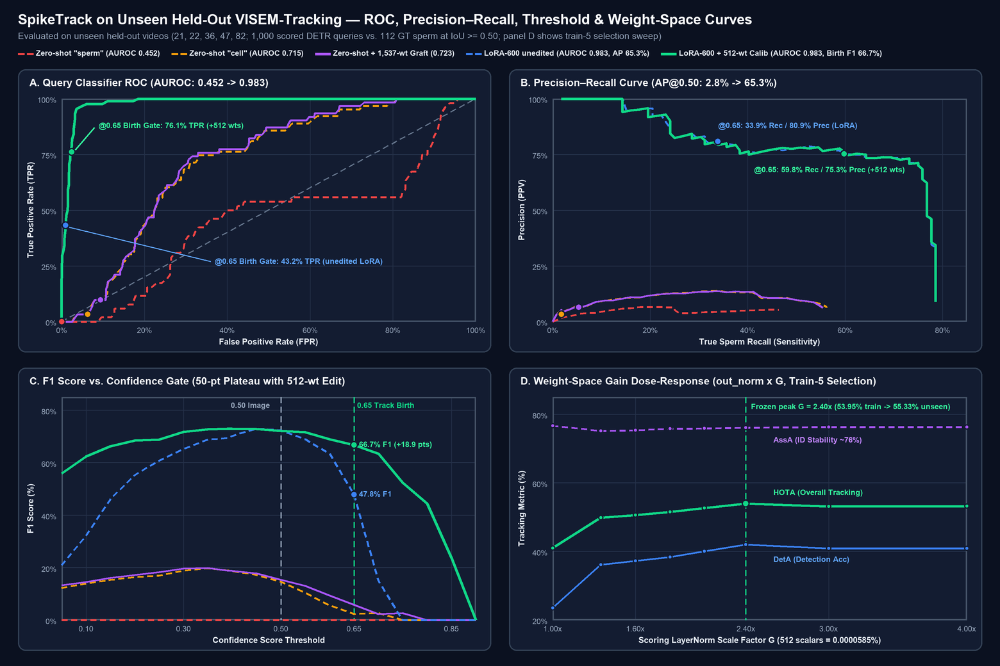
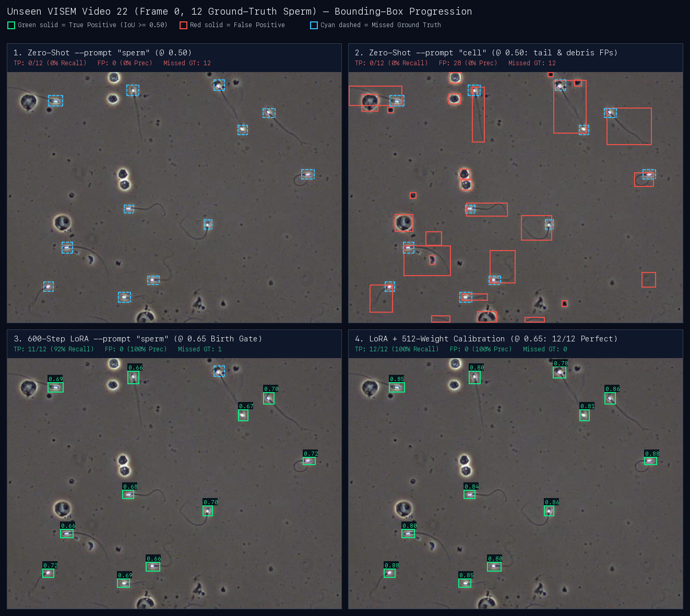
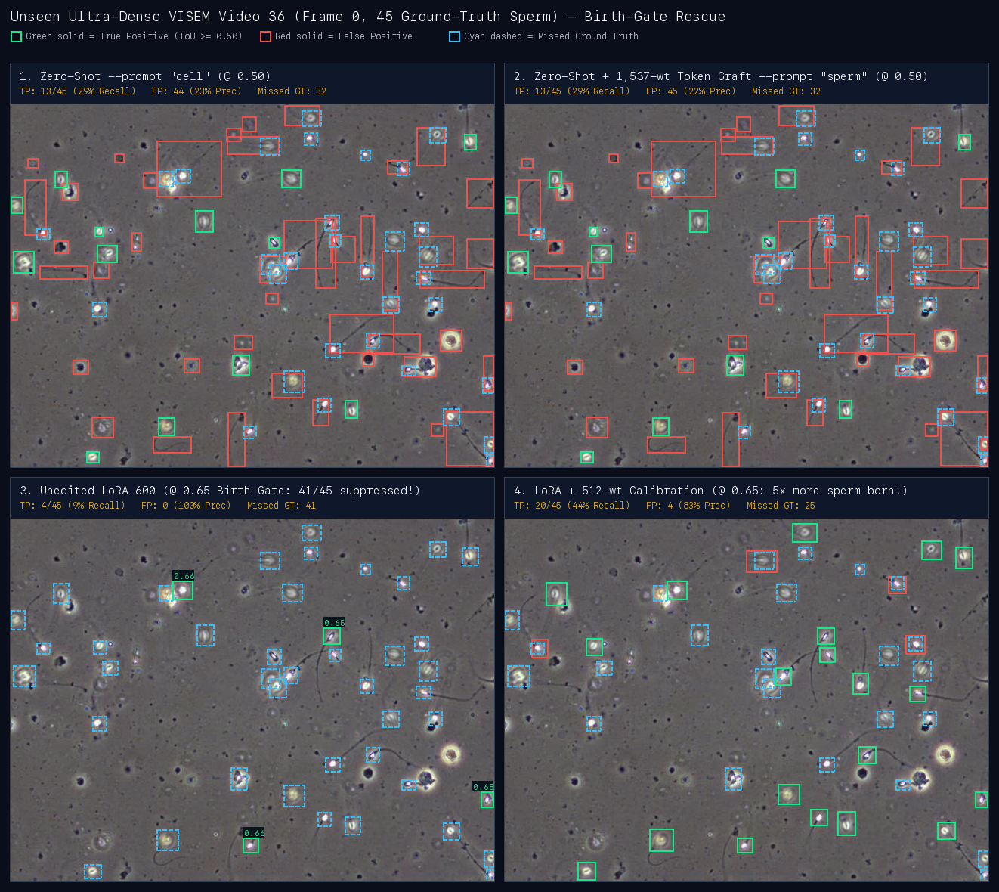
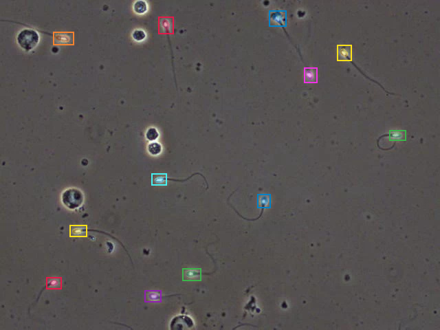
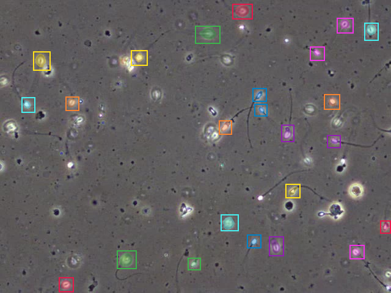
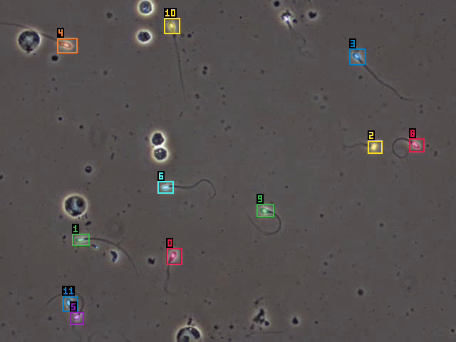

# Accuracy, ROC / Precision–Recall Curves & Visual Bounding-Box Comparisons

Every metric and image in this document is measured on **unseen held-out VISEM-Tracking videos (`21`, `22`, `36`, `47`, `82`)** using the native Rust `spiketrack` binary on Apple Silicon Metal (no Python at runtime), except Panel D of Figure 1 which shows the `train`-split dose-response sweep (`14, 30, 19, 54, 13`) used to freeze `G = 2.40x` before touching the held-out set.

Backing committed artifacts:
- Continuous `[0..1]` ROC / PR / threshold sweep & 1,500-frame box metrics: [`bench/results/weight-space/roc_pr_held_out_f0.json`](../bench/results/weight-space/roc_pr_held_out_f0.json)
- 120-frame image detection, negative specificity & ECE: [`bench/results/lora/visem-lora-r16/eval.md`](../bench/results/lora/visem-lora-r16/eval.md) and [`eval.json`](../bench/results/lora/visem-lora-r16/eval.json)
- Weight-space diagnostics, falsified edits & 8f/32f video tracking: [`bench/results/weight-space/README.md`](../bench/results/weight-space/README.md)
- 1,500-frame held-out video tracking runs: [`bench/results/SUMMARY.md`](../bench/results/SUMMARY.md)

---

## 1. Plain-English Metric Guide

Because object detection and multi-object video tracking involve variable numbers of objects per frame (8 to 46 sperm per microscope view) and `200` candidate DETR object queries per frame, naive slot-level "accuracy" is misleading: **zero-shot `"sperm"` predicts `0` boxes everywhere and still scores `94.8%` raw query-slot accuracy** because ~180 of 200 query slots are background! We report standard detection, classification, calibration, and tracking metrics together:

| Metric | Formula / Definition | Plain-English Meaning |
|---|---|---|
| **Precision (PPV)** | `TP / (TP + FP)` | When SpikeTrack draws a sperm box, how often is it a real ground-truth sperm head (`IoU >= 0.50`)? |
| **Recall (Sensitivity / TPR)** | `TP / (TP + FN)` | Out of all real sperm in the microscope frame, what percentage did SpikeTrack find? |
| **F1 Score** | `2 * TP / (2 * TP + FP + FN)` | Harmonic balance of Precision and Recall (`0%` worst, `100%` perfect). |
| **Box Detection Accuracy (CSI)** | `TP / (TP + FP + FN)` | Strict instance-level accuracy (Critical Success Index / Threat Score) penalizing both false alarms (`FP`) and missed sperm (`FN`) without background-slot inflation. |
| **Query AUROC** | Area under `(FPR, TPR)` across all `200` DETR queries/frame | Probability (`0.50` = coin flip, `1.00` = ideal) that a query matching a real sperm head outranks a background/debris query. |
| **AP@0.50 (PR-AUC)** | Area under the Precision–Recall curve (`IoU >= 0.50`) | Overall detection quality integrated across every confidence threshold from `1.0` down to `0.0`. |
| **Negative Specificity** | `1 - FPR` on absent everyday concepts (`600` items) | How reliably SpikeTrack outputs **zero** false boxes when prompted with absent concepts (`"car"`, `"person"`, `"dog"`, `"bicycle"`, etc.). |
| **ECE (10-bin)** | Expected Calibration Error | Gap between predicted confidence probability (e.g. `0.75`) and empirical hit frequency. |
| **HOTA** | $\sqrt{\text{DetA} \cdot \text{AssA}}$ integrated over `IoU in [0.05..0.95]` | Balanced video tracking score combining **detection** (`DetA`) and **identity persistence over time** (`AssA`). |
| **DetA / AssA / LocA** | TrackEval components of HOTA | **DetA**: multi-IoU frame detection accuracy; **AssA**: how consistently one sperm keeps the *same* ID across frames without switches; **LocA**: spatial box tightness (`IoU`) on matched sperm. |

---

## 2. ROC, Precision–Recall, Threshold Plateau & Weight-Space Gain Curves



### Key Takeaways from the Four Curves (`5` Unseen Videos, `1,000` Queries, `112` GT Sperm)

1. **Panel A — Query Classifier ROC (`AUROC: 0.452 -> 0.983`):**
   - Zero-shot `--prompt sperm` (`0.4523` AUROC) ranks sperm slightly *worse* than a random coin flip because `"sperm</w>"` (BPE row `35781`) sits in a clinical text cluster (`"ivf"`, `"fertility"`) rather than microscopy objects.
   - Zero-shot `1,537`-parameter weight-space grafting (`zeroshot_sperm_graft_calibrated.json`, `0.000176%` of SAM 3.1, zero gradients) jumps `--prompt sperm` to **`0.7229` AUROC**, matching and slightly edging zero-shot `--prompt cell` (`0.7148`).
   - 600-step detector LoRA (`visem-lora-r16`) pushes query discrimination to **`0.9832` AUROC**.
2. **Panel B — Precision–Recall (`AP@0.50: 2.8% -> 65.3%`):**
   - Average Precision jumps **23x** from `2.8%` (zero-shot `"sperm"`) and **9.1x** from `7.2%` (zero-shot `"cell"`) to **`65.3%`** with the detector LoRA.
   - Because scaling `detector.dot_prod_scoring.prompt_mlp.out_norm` by `2.40x` (**512 scalars = `0.0000585%` of SAM 3.1**) is a monotonic logit transformation on positive presence frames, it **preserves `AUROC` (`0.9833`) and `AP@0.50` (`65.2%`)** while sliding the **`0.65` VOS tracker birth gate** right along the PR curve from **`33.9%` Recall -> `59.8%` Recall (`+25.9` pts)** at `75.3%` Precision.
3. **Panel C — Confidence-Gate Sensitivity (`50`-Point F1 Plateau):**
   - Unedited LoRA peaks near `0.45` (`73.0%` F1) but drops sharply to **`47.8%` F1** at SAM 3.1's `0.65` VOS birth gate because `dot_prod_scoring` was frozen during LoRA training, leaving dozens of real sperm compressed in `[0.50, 0.64]`.
   - Editing those 512 LayerNorm scalars creates a **flat `66.7%–73.0%` F1 plateau spanning thresholds `0.15` through `0.65`**, boosting birth-gate F1 by **`+18.9` points (`47.8% -> 66.7%`)** and Box Detection Accuracy from **`31.4% -> 50.0%`**.
4. **Panel D — Train-Split Dose-Response (`G = 1.00x .. 4.00x`):**
   - Sweeping `out_norm` gain on the 5 training videos (`14, 30, 19, 54, 13`) exhibits a clean unimodal peak at **`G = 2.40x`** (`HOTA 40.92% -> 53.95%`, `DetA 23.47% -> 41.96%`), while identity stability (`AssA ~76%`) holds flat. Frozen and evaluated once on the 5 unseen held-out videos, `G = 2.40x` transfers cleanly to **`55.33%` HOTA** (8f) and **`55.26%` HOTA** (32f).

---

## 3. Side-by-Side Quantitative Comparisons Across Scales

### 3.1 Continuous `[0..1]` Sweep on Unseen Held-Out Frame `0` (`5` Videos, `1,000` Queries, `112` GT Sperm)

Source: [`bench/results/weight-space/roc_pr_held_out_f0.json`](../bench/results/weight-space/roc_pr_held_out_f0.json) (`spiketrack image --threshold 0.0`, greedy `IoU >= 0.50`).

| Model Stage (`--prompt sperm` unless noted) | Params Changed | Query AUROC | AP@0.50 | `@ 0.50` Image Gate: Prec / Rec / F1 / Box Acc (`FP/f`) | `@ 0.65` Track Birth Gate: Prec / Rec / F1 / Box Acc (`TP/112`, `FP/f`) |
|---|---:|---:|---:|---|---|
| **1. Zero-shot `"sperm"`** | `0` | `0.4523` | `2.8%` | `—` / `0.0%` / `0.0%` / `0.0%` (`0.0`) | `—` / `0.0%` / `0.0%` / `0.0%` (`0/112`, `0.0`) |
| **2. Zero-shot `"cell"`** | `0` | `0.7148` | `7.2%` | `11.6%` / `19.6%` / `14.6%` / `7.9%` (`33.4`) | `3.3%` / `1.8%` / `2.3%` / `1.2%` (`2/112`, `11.8`) |
| **3. Zero-shot + Weight Graft** (`0` grads) | `1,537` (`0.00018%`) | `0.7229` | `7.0%` | `11.9%` / `21.4%` / `15.3%` / `8.3%` (`35.4`) | `6.4%` / `5.4%` / `5.8%` / `3.0%` (`6/112`, `17.6`) |
| **4. 600-Step LoRA** (`visem-lora-r16`) | `983,040` LoRA | **`0.9832`** | **`65.3%`** | `73.4%` / **`71.4%`** / **`72.4%`** / **`56.7%`** (`5.8`) | **`80.9%`** / `33.9%` / `47.8%` / `31.4%` (`38/112`, **`1.8`**) |
| **5. LoRA + 512-wt Calibration** (`0` extra grads) | `+512` (`0.000059%`) | **`0.9833`** | **`65.2%`** | **`73.8%`** / `70.5%` / `72.1%` / `56.4%` (`5.6`) | `75.3%` / **`59.8%`** / **`66.7%`** / **`50.0%`** (**`67/112`**, `4.4`) |

### 3.2 120-Frame Unseen Image Detection, Specificity & Calibration (`2,603` GT Sperm + `756` Negative/Absent Tests)

Source: [`bench/results/lora/visem-lora-r16/eval.json`](../bench/results/lora/visem-lora-r16/eval.json) (`24` evenly spaced frames x `5` held-out videos).

| Configuration | Score Gate | TP / `2,603` | FP (`FP/frame`) | Precision | Recall | F1 Score | Box Accuracy | Everyday Negative Specificity (`600` items) | Presence ECE |
|---|---:|---:|---:|---:|---:|---:|---:|---:|---:|
| Zero-shot `"sperm"` | `0.50` | `0` | `0` (`0.0`) | `—` | `0.0%` | `0.0%` | `0.0%` | `100.0%` (`0/600` FP) | `0.1769` |
| Zero-shot `"cell"` | `0.30` | `1,107` | `8,373` (`69.8`) | `11.7%` | `42.5%` | `18.4%` | `10.1%` | `100.0%` (`0/600` FP) | `0.1769` |
| Zero-shot `"cell"` | `0.50` | `553` | `3,979` (`33.2`) | `12.2%` | `21.2%` | `15.5%` | `8.4%` | `100.0%` (`0/600` FP) | `0.1769` |
| **LoRA-600 `"sperm"`** | `0.30` | **`1,982`** | `1,411` (`11.8`) | `58.4%` | **`76.1%`** | `66.1%` | `49.4%` | **`100.0%` (`0/600` FP)** | **`0.0445`** |
| **LoRA-600 `"sperm"`** | `0.40` | `1,940` | `933` (`7.8`) | `67.5%` | `74.5%` | **`70.9%`** | **`54.9%`** | **`100.0%` (`0/600` FP)** | **`0.0445`** |
| **LoRA-600 `"sperm"`** | `0.50` | `1,780` | **`647` (`5.4`)** | **`73.3%`** | `68.4%` | `70.8%` | `54.8%` | **`100.0%` (`0/600` FP)** | **`0.0445`** |

*Note on related clinical classes:* While all `600` everyday negative `(frame, prompt)` items (`360` seen + `240` unseen negatives) remain at **`0.0%` false-positive rate (`100.0%` specificity)**, prompts for absent VISEM morphology classes (`"sperm cluster"`, `"pinhead sperm"`, `156` items) trigger a detection on `16.0%` of items after detector-only LoRA because those phrases share the frozen `"sperm</w>"` BPE token (`35781`).

### 3.3 Multi-Frame Video Tracking on Unseen Held-Out Videos (`160`-Frame & `1,500`-Frame Suites)

Sources: [`bench/results/weight-space/README.md`](../bench/results/weight-space/README.md), [`bench/results/weight-space/roc_pr_held_out_f0.json`](../bench/results/weight-space/roc_pr_held_out_f0.json), and [`bench/results/SUMMARY.md`](../bench/results/SUMMARY.md).

| Evaluation Horizon | Configuration | Boxes / Cap | HOTA | DetA | AssA (ID Stability) | LocA (Box IoU) | Frame-Box Precision / Recall / F1 / Box Acc (`IoU >= 0.50`) |
|---|---|---|---:|---:|---:|---:|---|
| **160 frames** (`5 x 32f`, `3,492` GT) | Zero-shot `"sperm"` | `detector` / `64` | `0.0000` | `0.0000` | `0.0000` | `1.0000` | `0` boxes output |
| **160 frames** (`5 x 32f`, `3,492` GT) | Zero-shot `"cell"` | `detector` / `16` | `0.1658` | `0.0589` | `0.5708` | `0.6595` | `2,395` pred boxes across `160` frames |
| **160 frames** (`5 x 32f`, `3,492` GT) | **Zero-shot `"sperm"` + `1,537`-wt Graft** | `detector` / `64` | **`0.2106`** | `0.0926` | `0.5503` | `0.6664` | Zero-gradient weight edit (`0.000176%` of model) |
| **160 frames** (`5 x 32f`, `3,492` GT) | LoRA-600 `"sperm"` (unedited) | `detector` / `64` | `0.4751` | `0.3162` | **`0.7909`** | **`0.7259`** | Per-video HOTA: `0.595 / 0.624 / 0.318 / 0.492 / 0.475` |
| **160 frames** (`5 x 32f`, `3,492` GT) | **LoRA-600 `"sperm"` + `512`-wt Calib** | `detector` / `64` | **`0.5526`** | **`0.4359`** | `0.7812` | `0.7202` | **All 5 videos up:** `0.639 / 0.649 / 0.490 / 0.543 / 0.517` |
| **1,500 frames** (`5 x 300f`, `32,949` GT) | Zero-shot `"cell"` (upstream baseline) | `mask` / `16` | `0.1549` | `0.0509` | `0.5942` | `0.659` | `6.6%` Prec / `4.6%` Rec / `5.4%` F1 / `2.8%` Box Acc (`1,524` TP, `21,514` FP) |
| **1,500 frames** (`5 x 300f`, `32,949` GT) | LoRA-600 `"sperm"` (upstream cap) | `detector` / `16` | `0.4695` | `0.3198` | **`0.7250`** | `0.713` | `3.0x` zero-shot HOTA (`bench/results/track/held300-lora600-sperm-detector`) |
| **1,500 frames** (`5 x 300f`, `32,949` GT) | **LoRA-600 `"sperm"` (Ojas `f32` & CoreML `fp32`)** | `detector` / `64` | **`0.4922`** | **`0.3734`** | `0.6903` | `0.708` | **`72.8%` Prec / `50.5%` Rec / `59.6%` F1 / `42.5%` Box Acc** (`16,639` TP, `6,221` FP = `4.15` FP/f) |

---

## 4. Visual Bounding-Box & Segmentation-Mask Comparisons

Every image below is rendered directly from **real `spiketrack` Metal outputs** on unseen held-out VISEM phase-contrast frames against VISEM normal-sperm head annotations (`class == 0`, greedy `IoU >= 0.50` matching):
- **Green solid box + score**: True Positive (`IoU >= 0.50` with ground-truth sperm head)
- **Red solid box**: False Positive (debris, non-sperm round cells, or 90 px whole-flagellum box missing the 20 px head)
- **Cyan dashed box**: Missed Ground-Truth Sperm (`FN` below threshold)

### 4.1 Four-Stage Progression on Unseen VISEM Video `22` (`12` Sperm)

- **Panel 1 (Zero-shot `"sperm"`):** `0/12` detected (`presence = 0.146` suppresses every query).
- **Panel 2 (Zero-shot `"cell"` `@ 0.50`):** `28` false-positive boxes enclose full 80–95 px tails and round phase-contrast artifacts (`0/12` head IoU matches).
- **Panel 3 (600-step LoRA `@ 0.65` Birth Gate):** Tightly localizes `11/12` sperm heads (`91.7%` Recall, `100%` Precision, `0` FP), leaving one true sperm just below `0.65` (`score = 0.63`).
- **Panel 4 (LoRA + 512-wt Calibration `@ 0.65` Birth Gate):** Lifts all 12 sperm heads cleanly into `0.78–0.88`, achieving **`12/12` (`100%` Recall, `100%` Precision, `100%` F1, `0` FP)**.



### 4.2 Dense-Swarm Birth-Gate Rescue on Unseen VISEM Video `36` (`45` Sperm)

Video `36` shows visually **why editing 512 frozen scoring LayerNorm parameters jumps 32-frame tracking HOTA on this video from `0.318` to `0.490` (`+54%` relative)**:
- At the `0.50` image threshold (top-right), unedited LoRA already detects **`30/45` sperm (`67%` Recall, `75%` Precision)** — proving the DETR queries found the crowded sperm heads.
- However, **`26` of those `30` true sperm sit in `[0.50, 0.649]`**, so SAM 3.1's `0.65` VOS tracker birth gate (bottom-left) kills them at birth, leaving only **`4/45` (`8.9%` Recall)**!
- Scaling `prompt_mlp.out_norm` by `2.40x` (bottom-right) rescues **`20/45` true sperm (`5x` more tracks born at frame `0`)** across the `0.65` birth gate with zero gradient steps.



### 4.3 Unseen Videos `21` (`21` Sperm) & `47` (`8` Sperm) Before vs. After 512-Weight Calibration

Across both moderate-density (`21`) and sparse (`47`) unseen videos at the `0.65` VOS birth gate:
- **Video `21`:** `15/21` TP (`71.4%` Recall, `93.8%` Precision) -> **`20/21` TP (`95.2%` Recall, `95.2%` Precision, `95.2%` F1)**
- **Video `47`:** `3/8` TP (`37.5%` Recall, `75.0%` Precision) -> **`8/8` TP (`100.0%` Recall, `100.0%` Precision, `100.0%` F1)**


### 4.4 Native `spiketrack` Segmentation Masks & Multi-Frame Track Identities

Unlike bounding-box-only detectors, `spiketrack` segments every spermatozoon (head + midpiece + flagellum mask) and propagates multiplex object states across frames:

| Unseen Video `22` Frame `0` (`spiketrack image --threshold 0.65`) | Unseen Dense Video `36` Frame `0` (`spiketrack image --threshold 0.65`) |
|---|---|
|  |  |

And across time (`spiketrack track --boxes detector` on held-out Video `22`, frame `30`, playable clip at [`bench/results/demo/22-sperm-lora.mp4`](../bench/results/demo/22-sperm-lora.mp4)):



---

## 5. Reproducing the Curves & Visual Overlays

```sh
cargo build --release -p spiketrack
export SPIKETRACK_WEIGHTS=~/Code/research/models/sam3.1/sam3.1_multiplex.safetensors
export SPIKETRACK_MODEL_DIR=~/Code/research/models/sam3.1

# 1. Full 200-query continuous score dump (--threshold 0.0) on all 5 unseen held-out videos
for VID in 21 22 36 47 82; do
  target/release/spiketrack image "data/visem/VISEM_Tracking_Train_v4/Train/$VID/images/${VID}_frame_0.jpg" \
    --prompt sperm --backend metal --threshold 0.0 \
    --lora fixtures/lora_runs/visem-lora-r16/adapter.safetensors \
    --weight-edit bench/results/weight-space/lora_scoring_outnorm_2p40.json \
    --out "out/roc-ws240/$VID"
done

# 2. Native segmentation mask + detector box overlays at the 0.65 VOS birth gate
for VID in 22 36; do
  target/release/spiketrack image "data/visem/VISEM_Tracking_Train_v4/Train/$VID/images/${VID}_frame_0.jpg" \
    --prompt sperm --backend metal --threshold 0.65 \
    --lora fixtures/lora_runs/visem-lora-r16/adapter.safetensors \
    --weight-edit bench/results/weight-space/lora_scoring_outnorm_2p40.json \
    --out "out/overlay-ws240/$VID"
done
```
