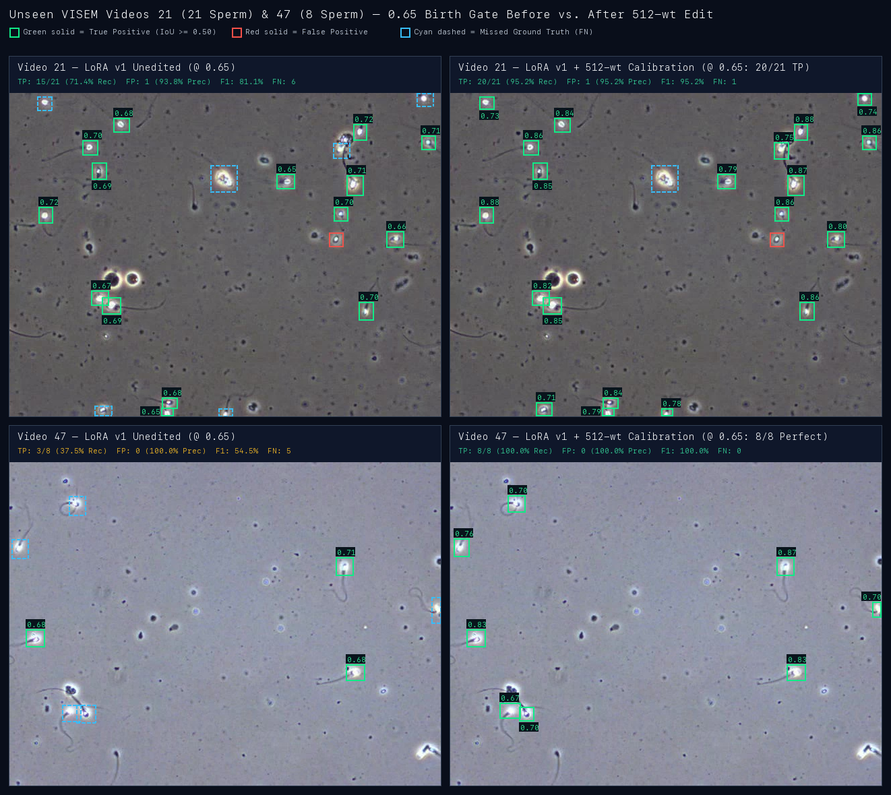
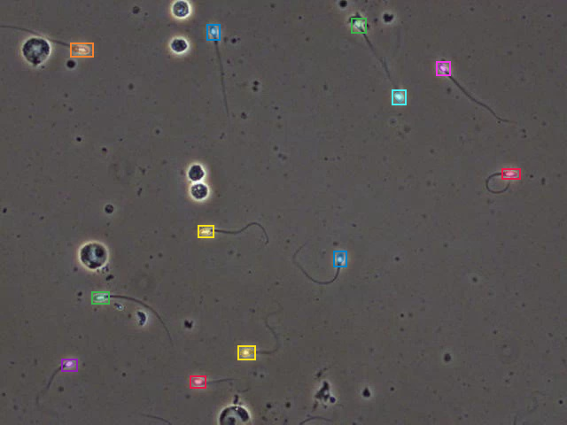
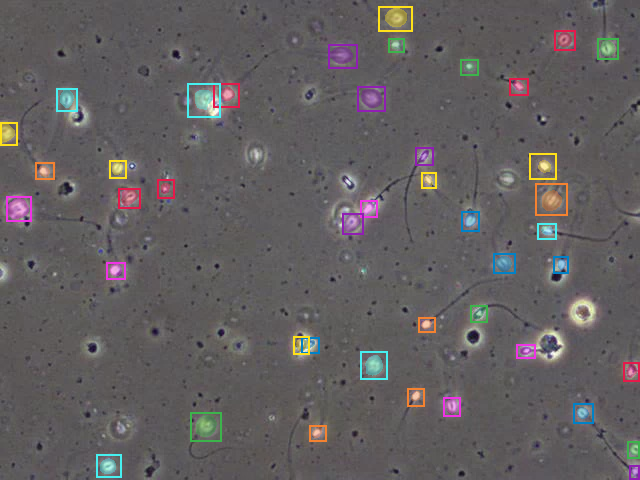

# Accuracy, ROC / Precision–Recall Curves & Visual Bounding-Box Comparisons

Every metric and image in this document is measured on **unseen held-out VISEM-Tracking videos (`21`, `22`, `36`, `47`, `82`)** using the native Rust `spiketrack` binary on Apple Silicon Metal (no Python at runtime), except Panel D of Figure 1 which shows the `train`-split dose-response sweep (`14, 30, 19, 54, 13`) used to freeze `G = 2.40x` (`G = 3.20x` for LoRA v2, `G = 3.00x` for LoRA v3) before touching the held-out set.

Backing committed artifacts:
- Continuous `[0..1]` ROC / PR / threshold sweep (v1, LoRA v2, LoRA v3, 768-wt exact IT, `--tile 2x2`) & 160f / 1,500f box metrics: [`bench/results/weight-space/roc_pr_held_out_f0.json`](../bench/results/weight-space/roc_pr_held_out_f0.json)
- 120-frame image detection, negative specificity & ECE: [`bench/results/lora/visem-lora-v3/eval.md`](../bench/results/lora/visem-lora-v3/eval.md) ([`eval.json`](../bench/results/lora/visem-lora-v3/eval.json)), [`visem-lora-v2-step400/eval.md`](../bench/results/lora/visem-lora-v2-step400/eval.md), [`visem-lora-v2/eval.md`](../bench/results/lora/visem-lora-v2/eval.md), and v1 [`visem-lora-r16/eval.md`](../bench/results/lora/visem-lora-r16/eval.md)
- Weight-space diagnostics, falsified edits, tracker ablations & 8f/32f video tracking: [`bench/results/weight-space/README.md`](../bench/results/weight-space/README.md)
- 1,500-frame held-out video tracking runs: [`bench/results/SUMMARY.md`](../bench/results/SUMMARY.md)

---

## 1. Plain-English Metric Guide

Because object detection and multi-object video tracking involve variable numbers of objects per frame (8 to 46 sperm per microscope view) and `200` candidate DETR object queries per frame (`n_queries = 1,126–1,145` across 5 frames after cross-scale NMS under `--tile 2x2`), naive slot-level "accuracy" is misleading: **zero-shot `"sperm"` predicts `0` boxes everywhere and still scores `94.8%` raw query-slot accuracy** because ~180 of 200 query slots are background! We report standard detection, classification, calibration, and tracking metrics together:

| Metric | Formula / Definition | Plain-English Meaning |
|---|---|---|
| **Precision (PPV)** | `TP / (TP + FP)` | When SpikeTrack draws a sperm box, how often is it a real ground-truth sperm head (`IoU >= 0.50`)? |
| **Recall (Sensitivity / TPR)** | `TP / (TP + FN)` | Out of all real sperm in the microscope frame, what percentage did SpikeTrack find? |
| **F1 Score** | `2 * TP / (2 * TP + FP + FN)` | Harmonic balance of Precision and Recall (`0%` worst, `100%` perfect). |
| **Box Detection Accuracy (CSI)** | `TP / (TP + FP + FN)` | Strict instance-level accuracy (Critical Success Index / Threat Score) penalizing both false alarms (`FP`) and missed sperm (`FN`) without background-slot inflation. |
| **Query AUROC** | Area under `(FPR, TPR)` across all candidate queries/frame | Probability (`0.50` = coin flip, `1.00` = ideal) that a query matching a real sperm head outranks a background/debris query. |
| **AP@0.50 (PR-AUC)** | Area under the Precision–Recall curve (`IoU >= 0.50`) | Overall detection quality integrated across every confidence threshold from `1.0` down to `0.0`. |
| **Negative Specificity** | `1 - FPR` on absent everyday concepts (`600` items) | How reliably SpikeTrack outputs **zero** false boxes when prompted with absent concepts (`"car"`, `"person"`, `"dog"`, `"bicycle"`, etc.). |
| **ECE (10-bin)** | Expected Calibration Error | Gap between predicted confidence probability (e.g. `0.75`) and empirical hit frequency. |
| **HOTA** | $\sqrt{\text{DetA} \cdot \text{AssA}}$ integrated over `IoU in [0.05..0.95]` | Balanced video tracking score combining **detection** (`DetA`) and **identity persistence over time** (`AssA`). |
| **DetA / AssA / LocA** | TrackEval components of HOTA | **DetA**: multi-IoU frame detection accuracy; **AssA**: how consistently one sperm keeps the *same* ID across frames without switches; **LocA**: spatial box tightness (`IoU`) on matched sperm. |

---

## 2. ROC, Precision–Recall, Threshold Plateau & Weight-Space Gain Curves


### Key Takeaways from the Four Curves (`5` Unseen Videos, `1,000` Single-Scale / `1,126–1,145` Tiled Queries, `112` GT Sperm)

1. **Panel A — Query Classifier ROC (`AUROC: 0.452 -> 0.983 -> 0.995`):**
   - Zero-shot `--prompt sperm` (`0.4523` AUROC) ranks sperm slightly *worse* than a random coin flip because `"sperm</w>"` (BPE row `35781`) sits in a clinical text cluster (`"ivf"`, `"fertility"`) rather than microscopy objects.
   - Zero-shot `1,537`-parameter weight-space grafting (`zeroshot_sperm_graft_calibrated.json`, `0.000176%` of SAM 3.1, zero gradients) jumps `--prompt sperm` to **`0.7229` AUROC**, matching and slightly edging zero-shot `--prompt cell` (`0.7148`).
   - 600-step detector LoRA (`visem-lora-r16`) pushes query discrimination to **`0.9832` AUROC**, enhanced `visem-lora-v2` (O2M `topk=4` + scoring/bbox/resizer heads, `s400`) reaches **`0.9872` AUROC** single-scale and **`0.9951` AUROC** with `--tile 2x2`, and `visem-lora-v3` (adding BPE `token_embedding` rows + focal negative query suppression, `s160`) reaches **`0.9835` AUROC** single-scale and **`0.9945` AUROC** with `--tile 2x2` (lifting `@0.65` query TPR across `43.2% -> 76.1% -> 88.8% -> 96.0%`, corresponding to `33.9% -> 59.8% -> 77.7% -> 84.8%` ground-truth sperm recall).
2. **Panel B — Precision–Recall (`AP@0.50: 2.8% -> 65.3% -> 82.4% / 83.4%`):**
   - Average Precision jumps **23x** from `2.8%` (zero-shot `"sperm"`) to **`65.3%`** with v1 detector LoRA, **`74.9%`** / **`80.1%`** single-scale on LoRA v3 / v2, and **29.8x** to **`82.4%`** (LoRA v3 + `--tile 2x2`) and **`83.4%`** (LoRA v2 + `--tile 2x2`).
   - Because scaling `detector.dot_prod_scoring.prompt_mlp.out_norm` by `2.40x` (**512 scalars = `0.0000585%` of SAM 3.1**) — and in LoRA v2/v3, scaling `out_norm.{weight,bias}` + `prompt_proj.bias` together by `3.20x` / `3.00x` (**768 scalars = `0.0000877%`**, exact $s'_q = G \cdot s_q$) — is an order-preserving logit transformation, it **leaves `AUROC` and `AP@0.50` invariant to 5 decimal places** (`0.98716` / `80.14%` on v2; `0.98352` / `74.85%` on v3) while sliding the **`0.65` VOS tracker birth gate** right onto the F1 peak (`38/112 -> 67/112 -> 87/112 -> 95/112` TP across the plotted progression).
3. **Panel C — Confidence-Gate Sensitivity (`@0.65 Birth F1: 47.8% -> 66.7% -> 78.0% -> 83.7%`):**
   - Unedited v1 LoRA peaks near `0.45` (`73.0%` F1) but drops sharply to **`47.8%` F1** at SAM 3.1's `0.65` VOS birth gate because `dot_prod_scoring` was frozen during v1 LoRA training, leaving dozens of real sperm compressed in `[0.50, 0.649]`.
   - Editing 512 LayerNorm scalars on v1 creates a **flat `66.7%–73.0%` F1 plateau across `0.15..0.65`** (`47.8% -> 66.7%` F1 at `0.65`); LoRA v3 + 768-wt exact IT (`G = 3.00x`) lifts single-scale `@0.65` birth-gate F1 to **`78.0%`** (`79.5%` on v2), and adding `--tile 2x2` (with per-tile `Sam3Processor` presence scaling) creates a wide **`80%+` F1 plateau spanning thresholds `0.29` through `0.86`**, reaching **`83.7%` F1** at `0.65` (`95/112` TP, `20` FP = `4.0/f`, **`72.0%` Box Acc**, peaking at **`84.1%` F1** at `0.66`).
4. **Panel D — Train-5 Gain Sweep (`v1 G=2.40x -> 55.3% vs. v3 G=3.00x -> 61.2% / 60.3%`):**
   - Sweeping inverse-temperature gain across `G in [1.00x, 4.00x]` on the 5 training videos (`14, 30, 19, 54, 13`) rises sharply into a broad post-calibration plateau (`G = 2.40x` on v1: `HOTA 40.92% -> 53.95%`; `G = 3.20x` on v2 step 400: `HOTA 50.93% -> 57.59%`, before sparse video `14` over-predicts at `G >= 3.50x`; `G = 3.00x` on v3 step 160: selection-grid peak `HOTA 52.28% -> 58.02%` with max `DetA = 48.00%` and a flat `57.7%–58.1%` plateau across `G in [2.80x, 4.00x]`). Frozen and evaluated once on the 5 unseen held-out videos, v1 + `G = 2.40x` reaches `55.33%` (8f) / `55.26%` (32f) HOTA, while **v3 + `G = 3.00x` + tracker upgrades reach `61.21%` HOTA** (8f, `AssA = 81.15%`) and **`60.25%` HOTA** (32f, `AssA = 78.80%`).

---

## 3. Side-by-Side Quantitative Comparisons Across Scales

### 3.1 Continuous `[0..1]` Sweep on Unseen Held-Out Frame `0` (`5` Videos, `112` GT Sperm)

Source: [`bench/results/weight-space/roc_pr_held_out_f0.json`](../bench/results/weight-space/roc_pr_held_out_f0.json) (`spiketrack image --threshold 0.0`, greedy `IoU >= 0.50`; `n_queries = 1,000` single-scale, `n_queries = 1,145` on row 8 and `1,126` on row 11 after cross-scale NMS under `--tile 2x2`).

| Model Stage (`--prompt sperm` unless noted) | Params Changed | Query AUROC | AP@0.50 | `@ 0.50` Image Gate: Prec / Rec / F1 / Box Acc (`FP/f`) | `@ 0.65` Track Birth Gate: Prec / Rec / F1 / Box Acc (`TP/112`, `FP/f`) |
|---|---:|---:|---:|---|---|
| **1. Zero-shot `"sperm"`** | `0` | `0.4523` | `2.8%` | `—` / `0.0%` / `0.0%` / `0.0%` (`0.0`) | `—` / `0.0%` / `0.0%` / `0.0%` (`0/112`, `0.0`) |
| **2. Zero-shot `"cell"`** | `0` | `0.7148` | `7.2%` | `11.6%` / `19.6%` / `14.6%` / `7.9%` (`33.4`) | `3.3%` / `1.8%` / `2.3%` / `1.2%` (`2/112`, `11.8`) |
| **3. Zero-shot + Weight Graft** (`0` grads) | `1,537` (`0.00018%`) | `0.7229` | `7.0%` | `11.9%` / `21.4%` / `15.3%` / `8.3%` (`35.4`) | `6.4%` / `5.4%` / `5.8%` / `3.0%` (`6/112`, `17.6`) |
| **4. LoRA v1** (`visem-lora-r16`, 600 steps) | `983,040` LoRA | `0.9832` | `65.3%` | `73.4%` / `71.4%` / `72.4%` / `56.7%` (`5.8`) | `80.9%` / `33.9%` / `47.8%` / `31.4%` (`38/112`, `1.8`) |
| **5. LoRA v1 + 512-wt Calibration** (`0` extra grads) | `+512` (`0.000059%`) | `0.9833` | `65.2%` | `73.8%` / `70.5%` / `72.1%` / `56.4%` (`5.6`) | `75.3%` / `59.8%` / `66.7%` / `50.0%` (`67/112`, `4.4`) |
| **6. LoRA v2** (`visem-lora-v2`, O2M + heads, s400) | `1,127,697` LoRA | `0.9872` | `80.1%` | `78.2%` / `83.0%` / `80.5%` / `67.4%` (`5.2`) | **`90.4%`** / `58.9%` / `71.4%` / `55.5%` (`66/112`, **`1.4`**) |
| **7. LoRA v2 + 768-wt Exact IT** (`G = 3.20x`) | `+768` (`0.000088%`) | `0.9872` | `80.1%` | `78.2%` / `83.0%` / `80.5%` / `67.4%` (`5.2`) | `79.5%` / `79.5%` / `79.5%` / `65.9%` (`89/112`, `4.6`) |
| **8. LoRA v2 + 768-wt + `--tile 2x2`** (`1,145` q) | `+0` extra weights | **`0.9951`** | **`83.4%`** | `78.7%` / `85.7%` / `82.1%` / `69.6%` (`5.2`) | `81.2%` / **`84.8%`** / `83.0%` / `70.9%` (**`95/112`**, `4.4`) |
| **9. LoRA v3** (`visem-lora-v3`, BPE tokens + neg-q, s160) | `1,131,797` LoRA | `0.9835` | `74.9%` | `74.2%` / `79.5%` / `76.7%` / `62.2%` (`6.2`) | `85.7%` / `53.6%` / `65.9%` / `49.2%` (`60/112`, `2.0`) |
| **10. LoRA v3 + 768-wt Exact IT** (`G = 3.00x`) | `+768` (`0.000088%`) | `0.9835` | `74.9%` | `74.2%` / `79.5%` / `76.7%` / `62.2%` (`6.2`) | `78.4%` / `77.7%` / `78.0%` / `64.0%` (`87/112`, `4.8`) |
| **11. LoRA v3 + 768-wt + `--tile 2x2`** (`1,126` q) | `+0` extra weights | `0.9945` | `82.4%` | **`78.9%`** / **`86.6%`** / **`82.6%`** / **`70.3%`** (`5.2`) | **`82.6%`** / **`84.8%`** / **`83.7%`** / **`72.0%`** (**`95/112`**, `4.0`) |

### 3.2 120-Frame Unseen Image Detection, Specificity & Calibration (`2,603` GT Sperm + `756` Negative/Absent Tests)

Sources: [`bench/results/lora/visem-lora-r16/eval.json`](../bench/results/lora/visem-lora-r16/eval.json), [`bench/results/lora/visem-lora-v2-step400/eval.json`](../bench/results/lora/visem-lora-v2-step400/eval.json), and [`bench/results/lora/visem-lora-v3/eval.json`](../bench/results/lora/visem-lora-v3/eval.json) (`24` evenly spaced frames x `5` held-out videos).

| Configuration | Score Gate | TP / `2,603` | FP (`FP/frame`) | Precision | Recall | F1 Score | Box Accuracy | Everyday Negative Specificity (`600` items) | Absent Morphology FPR (`156` items, `@0.50`) |
|---|---:|---:|---:|---:|---:|---:|---:|---:|---:|
| Zero-shot `"sperm"` | `0.50` | `0` | `0` (`0.0`) | `—` | `0.0%` | `0.0%` | `0.0%` | `100.0%` (`0/600` FP) | `0.0%` (`presence > 0.5`: `35.9%`) |
| Zero-shot `"cell"` | `0.30` | `1,107` | `8,373` (`69.8`) | `11.7%` | `42.5%` | `18.3%` | `10.1%` | `100.0%` (`0/600` FP) | `0.0%` |
| Zero-shot `"cell"` | `0.50` | `553` | `3,979` (`33.2`) | `12.2%` | `21.2%` | `15.5%` | `8.4%` | `100.0%` (`0/600` FP) | `0.0%` |
| LoRA v1 `"sperm"` (`visem-lora-r16`) | `0.30` | `1,982` | `1,411` (`11.8`) | `58.4%` | `76.1%` | `66.1%` | `49.4%` | **`100.0%` (`0/600` FP)** | `16.0%` (`presence > 0.5`: `32.7%`) |
| LoRA v1 `"sperm"` (`visem-lora-r16`) | `0.40` | `1,940` | **`933` (`7.8`)** | `67.5%` | `74.5%` | `70.9%` | `54.9%` | **`100.0%` (`0/600` FP)** | `16.0%` |
| LoRA v1 `"sperm"` (`visem-lora-r16`) | `0.50` | `1,780` | **`647` (`5.4`)** | `73.3%` | `68.4%` | `70.8%` | `54.8%` | **`100.0%` (`0/600` FP)** | `16.0%` |
| LoRA v2 `"sperm"` (`visem-lora-v2`, s400) | `0.30` | **`2,099`** | `1,421` (`11.8`) | `59.6%` | **`80.6%`** | `68.6%` | `52.2%` | **`100.0%` (`0/600` FP)** | `33.3%` (`presence > 0.5`: `46.8%`) |
| LoRA v2 `"sperm"` (`visem-lora-v2`, s400) | `0.40` | `2,069` | `957` (`8.0`) | `68.4%` | `79.5%` | `73.5%` | `58.1%` | **`100.0%` (`0/600` FP)** | `33.3%` |
| LoRA v2 `"sperm"` (`visem-lora-v2`, s400) | `0.50` | `1,949` | `673` (`5.6`) | **`74.3%`** | **`74.9%`** | **`74.6%`** | **`59.5%`** | **`100.0%` (`0/600` FP)** | `33.3%` |
| **LoRA v3 `"sperm"` (`visem-lora-v3`, s160)** | `0.30` | `2,078` | `1,473` (`12.3`) | `58.5%` | `79.8%` | `67.5%` | `51.0%` | **`100.0%` (`0/600` FP)** | **`19.9%`** (`presence > 0.5`: **`27.6%`**) |
| **LoRA v3 `"sperm"` (`visem-lora-v3`, s160)** | `0.40` | `2,051` | `1,016` (`8.5`) | `66.9%` | `78.8%` | `72.3%` | `56.7%` | **`100.0%` (`0/600` FP)** | **`19.9%`** |
| **LoRA v3 `"sperm"` (`visem-lora-v3`, s160)** | `0.50` | `1,937` | `707` (`5.9`) | `73.3%` | `74.4%` | **`73.8%`** | **`58.5%`** | **`100.0%` (`0/600` FP)** | **`19.9%`** (**`-40.4%` vs v2**) |

*Note on related clinical classes & calibration:* All `600` everyday negative `(frame, prompt)` items (`360` seen + `240` unseen negatives) remain at **`0.0%` false-positive rate (`100.0%` specificity)** across v1, v2, and v3 (presence ECE / joint detection ECE: `0.0445 / 0.1103` on v1, `0.0598 / 0.1069` on v2 step 400, and `0.0675 / 0.1097` on v3). On absent VISEM morphology prompts (`"sperm cluster"`, `"pinhead sperm"`, `156` items), LoRA v2 jumped from `16.0% -> 33.3%` (`presence > 0.5: 46.8%`) because `token_embedding.weight` stayed frozen and upstream `IABCEMdetr` masks query classification loss on `num_boxes == 0`. Adapting CLIP BPE rows `(1375, 2629, 15595, 35781)` (`LoRAEmbeddingRows`) plus focal negative query suppression (`neg_query_weight = 1.5`) in **`visem-lora-v3` cuts unseen absent-class FPR by `-40.4%` relative (`33.3% -> 19.9%`) and `presence > 0.5` by `-41.1%` (`46.8% -> 27.6%`, below zero-shot `35.9%`)** while preserving `73.8%` `@0.50` `"sperm"` F1 (`+3.0` pts over v1).

### 3.3 Multi-Frame Video Tracking on Unseen Held-Out Videos (`160`-Frame & `1,500`-Frame Suites)

Sources: [`bench/results/weight-space/README.md`](../bench/results/weight-space/README.md), [`bench/results/weight-space/roc_pr_held_out_f0.json`](../bench/results/weight-space/roc_pr_held_out_f0.json), and [`bench/results/SUMMARY.md`](../bench/results/SUMMARY.md).

| Evaluation Horizon | Configuration | Boxes / Cap | HOTA | DetA | AssA (ID Stability) | LocA (Box IoU) | Frame-Box Precision / Recall / F1 / Box Acc (`IoU >= 0.50`) |
|---|---|---|---:|---:|---:|---:|---|
| **160 frames** (`5 x 32f`, `3,492` GT) | Zero-shot `"sperm"` | `detector` / `64` | `0.0000` | `0.0000` | `0.0000` | `1.0000` | `0` boxes output |
| **160 frames** (`5 x 32f`, `3,492` GT) | Zero-shot `"cell"` | `detector` / `16` | `0.1658` | `0.0589` | `0.5708` | `0.6595` | `2,395` pred boxes across `160` frames |
| **160 frames** (`5 x 32f`, `3,492` GT) | **Zero-shot `"sperm"` + `1,537`-wt Graft** | `detector` / `64` | `0.2106` | `0.0926` | `0.5503` | `0.6664` | Zero-gradient weight edit (`0.000176%` of model) |
| **160 frames** (`5 x 32f`, `3,492` GT) | LoRA v1 `"sperm"` (unedited, old tracker) | `detector` / `64` | `0.4751` | `0.3162` | **`0.7909`** | `0.7259` | Per-video HOTA: `0.595 / 0.624 / 0.318 / 0.492 / 0.475` |
| **160 frames** (`5 x 32f`, `3,492` GT) | LoRA v1 + `512`-wt Calib (old tracker) | `detector` / `64` | `0.5526` | `0.4359` | `0.7812` | `0.7202` | Per-video HOTA: `0.639 / 0.649 / 0.490 / 0.543 / 0.517` |
| **160 frames** (`5 x 32f`, `3,492` GT) | LoRA v1 + `512`-wt + **Head-Box NMS & Bulb Fallback** | `detector` / `64` | `0.5762` | `0.4689` | `0.7864` | `0.7219` | Tracker-only `+2.36` HOTA: `0.690 / 0.660 / 0.513 / 0.585 / 0.522` |
| **160 frames** (`5 x 32f`, `3,492` GT) | LoRA v2 `"sperm"` (`s400`, raw `G=1.00`) | `detector` / `64` | `0.5736` | `0.4578` | `0.7710` | **`0.7390`** | **`81.7%`** Prec / `65.1%` Rec / `72.4%` F1 / `56.8%` Box Acc (`2,272` TP) |
| **160 frames** (`5 x 32f`, `3,492` GT) | LoRA v2 (`s400`) + `768`-wt Exact IT (`G=3.20`) | `detector` / `64` | `0.6013` | **`0.5028`** | `0.7746` | `0.7343` | `74.6%` Prec / `76.0%` Rec / **`75.3%` F1** / **`60.4%` Box Acc** (`2,655` TP; `0.667 / 0.688 / 0.576 / 0.549 / 0.557`) |
| **160 frames** (`5 x 32f`, `3,492` GT) | LoRA v3 `"sperm"` (`s160`, raw `G=1.00`) | `detector` / `64` | `0.5751` | `0.4613` | `0.7817` | `0.7362` | `80.4%` Prec / `64.9%` Rec / `71.9%` F1 / `56.1%` Box Acc (`2,267` TP) |
| **160 frames** (`5 x 32f`, `3,492` GT) | **LoRA v3 (`s160`) + `768`-wt Exact IT (`G=3.00`)** | `detector` / `64` | **`0.6025`** | `0.5026` | **`0.7880`** | `0.7338` | `74.1%` Prec / **`76.3%` Rec** / `75.2%` F1 / `60.2%` Box Acc (**`2,666` TP**; **all 5 up:** `0.674 / 0.680 / 0.575 / 0.560 / 0.555`) |
| **1,500 frames** (`5 x 300f`, `32,949` GT) | Zero-shot `"cell"` (upstream baseline) | `mask` / `16` | `0.1549` | `0.0509` | `0.5942` | `0.659` | `6.6%` Prec / `4.6%` Rec / `5.4%` F1 / `2.8%` Box Acc (`1,524` TP, `21,514` FP) |
| **1,500 frames** (`5 x 300f`, `32,949` GT) | LoRA v1 `"sperm"` (upstream cap, old tracker) | `detector` / `16` | `0.4695` | `0.3198` | **`0.7250`** | `0.713` | `3.0x` zero-shot HOTA (`bench/results/track/held300-lora600-sperm-detector`) |
| **1,500 frames** (`5 x 300f`, `32,949` GT) | **LoRA v1 `"sperm"` (Ojas `f32` & CoreML `fp32`)** | `detector` / `64` | **`0.4922`** | **`0.3734`** | `0.6903` | `0.708` | **`72.8%` Prec / `50.5%` Rec / `59.6%` F1 / `42.5%` Box Acc** (`16,639` TP, `6,221` FP = `4.15` FP/f) |

*(Note: The `1,500`-frame `5 x 300f` runs were measured on `visem-lora-r16` prior to `visem-lora-v2`/`v3` and the head-box NMS / morphological bulb tracker upgrades; `visem-lora-v3` + `768`-wt exact IT [`G = 3.00`] was evaluated on the `5 x 8f = 40`-frame [`0.6121` HOTA, `AssA = 0.8115`] and `5 x 32f = 160`-frame [`0.6025` HOTA, `AssA = 0.7880`] unseen held-out suites.)*

---

## 4. Visual Bounding-Box & Segmentation-Mask Comparisons

Every image below is rendered directly from **real `spiketrack` Metal outputs** on unseen held-out VISEM phase-contrast frames against VISEM normal-sperm head annotations (`class == 0`, greedy `IoU >= 0.50` matching):
- **Green solid box + score**: True Positive (`IoU >= 0.50` with ground-truth sperm head)
- **Red solid box**: False Positive (debris, non-sperm round cells, or 90 px whole-flagellum box missing the 20 px head)
- **Cyan dashed box**: Missed Ground-Truth Sperm (`FN` below threshold)

### 4.1 Four-Stage Progression on Unseen VISEM Video `22` (`12` Sperm)

- **Panel 1 (`Zero-Shot --prompt "sperm"` `@ 0.50`):** `0/12` detected (`0.0%` Recall, `0` FP, `0.0%` F1, `12` FN — `presence = 0.173` on `22_frame_0` [`0.146` 5-video mean] suppresses every query).
- **Panel 2 (`Zero-Shot --prompt "cell"` `@ 0.50`):** `0/12` head IoU matches (`0.0%` Recall, `28` FP, `0.0%` Precision, `0.0%` F1, `12` FN — boxes enclose full 80–95 px tails and round phase-contrast artifacts).
- **Panel 3 (`LoRA v1 Unedited --prompt "sperm"` `@ 0.65` Birth Gate):** Tightly localizes `11/12` sperm heads (`91.7%` Recall, `0` FP, `100.0%` Precision, `95.7%` F1, `1` FN), leaving one true sperm just below `0.65` (`score = 0.646`).
- **Panel 4 (`LoRA v1 + 512-wt Calibration` `@ 0.65` Birth Gate):** Lifts all 12 sperm heads cleanly into `0.78–0.88` with zero gradient steps, achieving **`12/12` (`100.0%` Recall, `0` FP, `100.0%` Precision, `100.0%` F1, `0` FN)** — and `LoRA v3 + 768-wt` (`0.87–0.96`) and `+ --tile 2x2` (`0.94–0.97`, Section 4.4) maintain the same **`12/12` (`0` FP, `100.0%` F1)**.


### 4.2 Dense-Swarm Birth-Gate Rescue on Unseen VISEM Video `36` (`45` Sperm)

Video `36` shows visually **why SAM 3.1's `0.65` VOS birth gate suppresses uncalibrated dense swarms (`30/45` TP [`66.7%` Recall, `8` FP, `78.9%` Precision] at `@ 0.50`, with `26` of those `30` true sperm compressed in `[0.50, 0.649]`), why editing 512 frozen LayerNorm scalars jumps 32-frame Video `36` HOTA from `0.318` to `0.490` (`+54%`), and why `LoRA v3 + 768-wt` + `--tile 2x2` rescues `38/45` (`84.4%` Recall, `86.4%` F1) at `@ 0.65`**:
- **Panel 1 (`LoRA v1 Unedited` `@ 0.65` Birth Gate):** Only **`4/45` TP** (`8.9%` Recall, `0` FP, `100.0%` Precision, `16.3%` F1, `41` FN) cross `0.65` — **`41/45` true sperm suppressed at birth**.
- **Panel 2 (`LoRA v1 + 512-wt Calibration` `@ 0.65, G=2.40x`):** Rescues **`20/45` TP** (`44.4%` Recall, `4` FP, `83.3%` Precision, `58.0%` F1, `25` FN — **`5x` births** with zero extra training).
- **Panel 3 (`LoRA v3 + 768-wt Exact IT` `@ 0.65, G=3.00x`):** O2M (`topk=4`) + head/BPE adaptation + 768-wt exact IT rescues **`31/45` TP** (`68.9%` Recall, `8` FP, `79.5%` Precision, `73.8%` F1, `14` FN — **`7.75x` births**), pushing 32-frame Video `36` HOTA to **`0.575`** (`0.576` on v2, `+81%` over raw v1).
- **Panel 4 (`LoRA v3 + 768-wt + --tile 2x2` `@ 0.65`):** Overlapping `2x2` tiles + cross-scale NMS rescue **`38/45` TP** (`84.4%` Recall, `5` FP, `88.4%` Precision, **`86.4%` F1**, `7` FN — **`9.5x` births** over raw v1), and similarly lift dense/defocused Video `82` (`26` sperm) across `5/26 (25.6% F1) -> 7/26 -> 16/26 (60.4% F1) -> 21/26 (80.8% Recall, 77.8% Precision, 79.2% F1)`, bringing total held-out frame-`0` birth-gate recall to **`95/112` (`84.8%` Recall, `82.6%` Precision, `83.7%` F1)**.


### 4.3 Unseen Videos `21` (`21` Sperm) & `47` (`8` Sperm) Before vs. After 512-Weight Calibration

Across both moderate-density (`21`) and sparse (`47`) unseen videos at the `0.65` VOS birth gate (`LoRA v1 Unedited` vs. `LoRA v1 + 512-wt Calibration`, `G = 2.40x`):
- **Video `21`:** `15/21` TP (`71.4%` Recall, `1` FP, `93.8%` Precision, `81.1%` F1, `6` FN) -> **`20/21` TP (`95.2%` Recall, `1` FP, `95.2%` Precision, `95.2%` F1, `1` FN)**
- **Video `47`:** `3/8` TP (`37.5%` Recall, `0` FP, `100.0%` Precision, `54.5%` F1, `5` FN) -> **`8/8` TP (`100.0%` Recall, `0` FP, `100.0%` Precision, `100.0%` F1, `0` FN)**

*(Single-scale `LoRA v3 + 768-wt` likewise reaches `20/21` TP [`95.2%` Recall] on Video `21` and `8/8` TP [`100.0%` Recall] on Video `47`; `--tile 2x2` targets dense small-object fields like Videos `36` and `82` [`59/71` TP vs. `47/71` single-scale] and trades slightly more zoom-tile FPs on sparse larger-head fields [`18/21` TP, `5` FP on `21`; `6/8` TP, `4` FP on `47`], so `--tile 2x2` remains opt-in while single-scale `LoRA v3 + 768-wt` drives the `0.6121` / `0.6025` HOTA VOS tracker default.)*



### 4.4 Native `spiketrack` Segmentation Masks & Multi-Frame Track Identities

Unlike bounding-box-only detectors, `spiketrack` segments every spermatozoon (head + midpiece + flagellum mask) and propagates multiplex object states across frames (`LoRA v3 + 768-wt + --tile 2x2` at `--threshold 0.65`: `12/12` masks on Video `22`, `43` detections / `38/45` TP on dense Video `36`):

| Unseen Video `22` Frame `0` (`spiketrack image --threshold 0.65 --tile 2x2`) | Unseen Dense Video `36` Frame `0` (`spiketrack image --threshold 0.65 --tile 2x2`) |
|---|---|
|  |  |

And across time (`spiketrack track --boxes detector` on held-out Video `22`, frame `30`, playable clip at [`bench/results/demo/22-sperm-lora.mp4`](../bench/results/demo/22-sperm-lora.mp4)):


---

## 5. Reproducing the Curves & Visual Overlays

```sh
cargo build --release -p spiketrack
export SPIKETRACK_WEIGHTS=~/Code/research/models/sam3.1/sam3.1_multiplex.safetensors
export SPIKETRACK_MODEL_DIR=~/Code/research/models/sam3.1

# 1. Full continuous score dump (--threshold 0.0) with LoRA v3 + 768-wt exact IT (and optional --tile 2x2)
for VID in 21 22 36 47 82; do
  target/release/spiketrack image "data/visem/VISEM_Tracking_Train_v4/Train/$VID/images/${VID}_frame_0.jpg" \
    --prompt sperm --backend metal --threshold 0.0 \
    --lora fixtures/lora_runs/visem-lora-v3/adapter.safetensors \
    --weight-edit bench/results/weight-space/lorav3_exact_it_3p00.json \
    --tile 2x2 --out "out/roc-lorav3-tile/$VID"
done

# 2. 32-frame unseen held-out tracking (0.6025 HOTA / 0.7880 AssA across 21, 22, 36, 47, 82; 0.6121 HOTA on 8f)
for VID in 21 22 36 47 82; do
  target/release/spiketrack track "data/visem/VISEM_Tracking_Train_v4/Train/$VID/images" \
    --prompt sperm --backend metal --max-frames 32 --boxes detector \
    --lora fixtures/lora_runs/visem-lora-v3/adapter.safetensors \
    --weight-edit bench/results/weight-space/lorav3_exact_it_3p00.json \
    --out out/held32-lorav3
done
target/release/spiketrack eval-visem --pred out/held32-lorav3 \
  --split tools/reference/visem_split.json --set held_out --max-frames 32

# 3. Native segmentation mask + detector box overlays at the 0.65 VOS birth gate (Section 4.4)
for VID in 22 36; do
  target/release/spiketrack image "data/visem/VISEM_Tracking_Train_v4/Train/$VID/images/${VID}_frame_0.jpg" \
    --prompt sperm --backend metal --threshold 0.65 \
    --lora fixtures/lora_runs/visem-lora-v3/adapter.safetensors \
    --weight-edit bench/results/weight-space/lorav3_exact_it_3p00.json \
    --tile 2x2 --out "out/overlay-lorav3-tile2x2/$VID"
done
```
