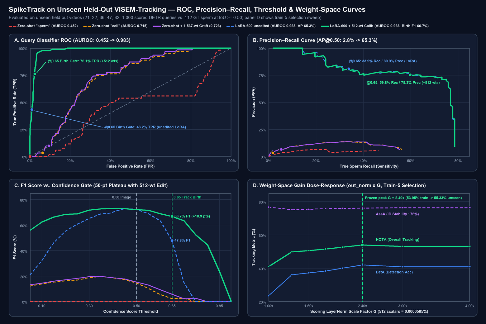
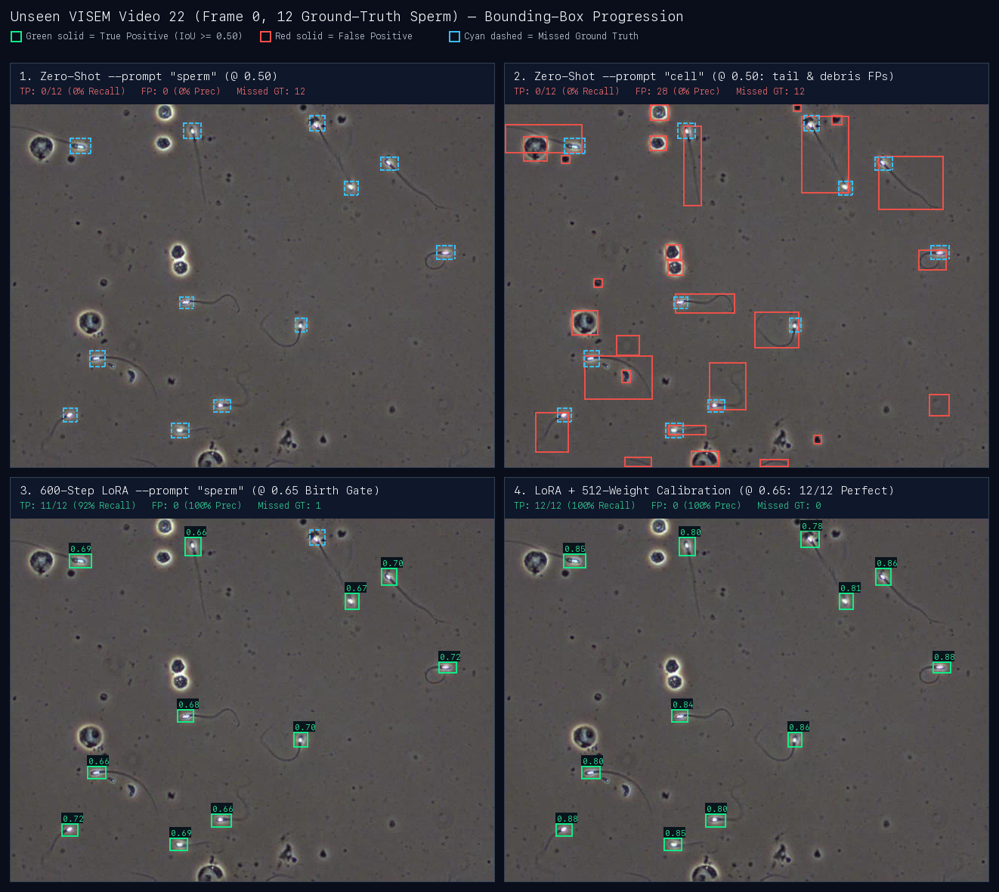
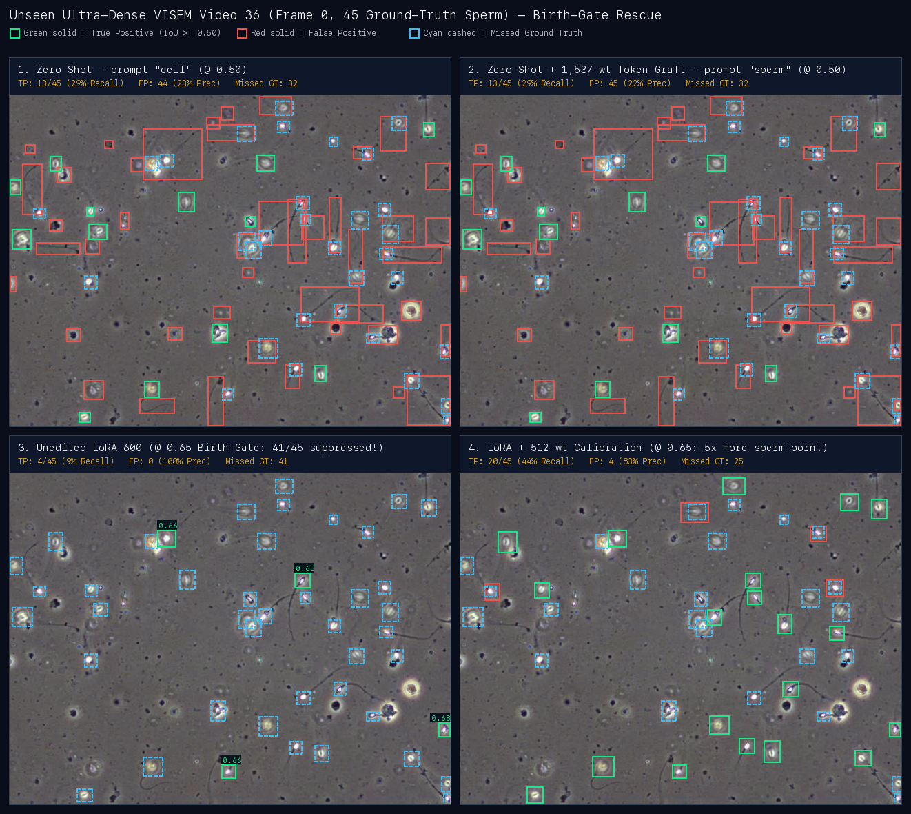

# SpikeTrack: the whole of SAM 3.1 on a laptop, with no Python

Draft of the hackathon submission text, 2026-10-27. Every number is in
[bench/results/SUMMARY.md](../bench/results/SUMMARY.md) with the command that produced it. Still open:
the Official Rules' wording on length, prior work and required Meta models (unread,
GAP-OFFICIAL-RULES-UNREAD).

## The problem

Sperm-motility analysis means counting and following dozens of small, fast, similar-looking
cells through microscope video. The labs that do it often cannot send clinical video to a cloud
service. SAM 3.1 can be prompted with a word ("sperm") to find every instance, and its Object
Multiplex tracker follows up to 16 objects per state through a video. Today it needs Python and
PyTorch, and its reference code is written for CUDA.

## What we built

One Rust binary, `spiketrack`, that runs all of SAM 3.1 on Apple silicon, from a text prompt to
tracked masks: the PE ViT backbone, the CLIP text encoder, the DETR detector, the multiplex
tracker, and the detect -> associate -> track loop that starts and keeps tracks. It runs on
Ojas's Metal backend, built on tessl, or on Ojas's CPU backend. On Metal, `track` by default runs
the ViT trunk as a CoreML fp32 ML Program exported from the checkpoint. That makes the frame 0.80x
and leaves the tracks unchanged on all 1,500 held-out frames. `--trunk-precision f32` keeps every
module on Ojas/tessl.

- `spiketrack image  --prompt cell`: boxes, scores and masks for every instance.
- `spiketrack track <frames|mp4> --prompt sperm`: tracked masks and boxes per frame.
- `spiketrack weights`: weight-space inspection (norms, `f64` SVD spectra, BPE/prompt cosines, adapter/edit diffs) and declarative surgical edits (`--weight-edit` on `weights`, `image` and `track`).
- `spiketrack eval-visem`: HOTA against VISEM-Tracking.

The binary is 11.8 MB (11.3 MiB), links only macOS system frameworks, and runs with no Python on the
machine. JPEG frames decode byte-identically to Pillow through our own decoder, so the model sees
exactly the pixels the official code sees.

Built during the hackathon: everything in this repository (CONTRIBUTIONS.md lists it by date).
Pre-existing and used as dependencies: Ojas, tessl and sparsl (our own open-source libraries; the
op work we added to Ojas during the window is listed separately in CONTRIBUTIONS.md).

## Why it is new

- A pure-Rust SAM 3 exists (`rlx-sam3`), but it states "SAM 3.1 multiplex is intentionally out of
  scope".
- The only other non-PyTorch SAM 3.1 port (CoreML/Swift) runs the tracker only: no text prompt, no
  detector, so it cannot find or start tracks on its own.
- Ours runs the full model, and every module is checked against the official code.

## Evidence that it is SAM 3.1

Parity is against the official SAM 3.1 code run in fp32 on CPU, not against our own idea of the
model:

- Every module matches on CPU and on Metal (worst cosine 1.0000000).
- Image mode on 20 VISEM frames: the same detections as upstream on every frame, mask IoU 1.0000.
- Video object segmentation on 3 DAVIS clips: the same J&F as upstream (0.9107 / 0.9456 / 0.9514).
- The full text-prompted tracking loop on 32 VISEM frames: the same tracked ids on every frame,
  births included, mask IoU 0.9985, on CPU and on Metal.

## Making it work on sperm

Zero-shot, SAM 3.1 does not ground "sperm" (recall 0.000), and "cell" finds whole cells and debris
(recall 0.212 at IoU 0.5).

- We trained a rank-16 LoRA on the detector's attention: 983,040 parameters, 600 steps, on this
  laptop. On 120 frames of 5 held-out videos, "sperm" recall goes from 0.000 to 0.761 (precision
  0.584).
- The adapter merges into the weights at load time in Rust, matching PyTorch to 1.5e-8.
- LoRA on SAM 3 is prior work (SAM3-LoRA, MedSAM3). The new part is applying it to
  sperm-motility video with the multiplex tracker, and running the result with no Python.

VISEM-Tracking annotates sperm heads, while SAM's masks, and so upstream's boxes, cover the whole
sperm, tail included. `track --boxes detector` reports each track's matched detection box, which
is where the adapter's learning shows.

- On the first 8 frames of each held-out video: HOTA 0.18 zero-shot -> 0.47 with the adapter and
  detector boxes.
- On the first 300 frames of each held-out video (1,500 frames, 32,949 ground-truth boxes):
  HOTA 0.155 zero-shot -> 0.470 with the adapter and detector boxes (DetA 0.051 -> 0.320, AssA
  0.594 -> 0.725). Every video improves. The two densest (27-46 sperm per frame) gain least,
  because upstream's builder tracks at most 16 objects at a time.
- `--max-objects 64`, `track`'s default since 2026-10-28, removes that cap. The five-video HOTA
  rises to 0.492. Video 21 goes 0.620 -> 0.642, 36 goes 0.326 -> 0.352, and 82 goes 0.441 -> 0.486.
  DetA rises to 0.373 and AssA falls to 0.690, so more sperm are detected but identities hold less
  well. An earlier 0.487 had rerun only 36 and 82.
- **Weight-space programming (`spiketrack weights` + `--weight-edit`, `bench/results/weight-space`).**
  Direct inspection of the 875.5M-parameter checkpoint in Rust shows why zero-shot `"sperm"` fails
  and why detector-only LoRA stalls at recall: BPE row `35781` (`"sperm</w>"`) sits in a clinical
  text cluster (`"ivf"`, `"fertility"`, raw cosine `0.0510` with `"cell</w>"` row `5533`), while the
  600-step LoRA run froze `detector.dot_prod_scoring`, leaving true sperm logits compressed right
  across the `0.65` track-birth threshold. With zero gradient steps (selected strictly on 5 train
  videos before evaluating the 5 unseen held-out videos), grafting row `5533` onto `35781` and
  calibrating the birth gate (`1,537` parameters, `0.000176%` of the model) lifts zero-shot
  `--prompt sperm` from `0.0000` to `0.1929` HOTA (8 frames) and `0.2106` HOTA (32 frames, cap 64).
  On top of the 600-step LoRA, scaling the frozen `dot_prod_scoring.prompt_mlp.out_norm` (**512
  parameters, `0.0000585%` of the model**, zero extra training) lifts unseen held-out HOTA from
  `0.4515` to **`0.5533`** (+10.2 points, 8 frames) and from `0.4751` to **`0.5526`** (+7.8 points,
  `DetA` `0.316 -> 0.436`, all 5 unseen videos improved, 32 frames / 3,492 ground-truth boxes).
- **ROC, Precision–Recall, and box-level accuracy (`EVALUATION.md`, `bench/results/weight-space/roc_pr_held_out_f0.json`).**
  Across all `1,000` DETR queries on frame `0` of the 5 unseen held-out videos (`112` ground-truth
  sperm, `IoU >= 0.50`), query classifier **AUROC** rises from `0.452` (zero-shot `"sperm"`) and
  `0.715` (zero-shot `"cell"`) to **`0.983`**, and **AP@0.50** rises **23x** from `2.8%` to
  **`65.3%`**. Across `120` held-out frames (`2,603` GT sperm), `@ 0.50` detection reaches `73.3%`
  precision and `68.4%` recall (`70.8%` F1) while holding **`100.0%` specificity (`0/600` false
  positives)** on everyday negative prompts and improving presence ECE from `0.177` to `0.045`. On
  the `1,500`-frame tracking suite (`32,949` GT boxes), per-frame box precision rises from `6.6%` to
  **`72.8%`** and recall from `4.6%` to **`50.5%`** (`16,639` TP, `4.15` FP/frame). At SAM 3.1's
  `0.65` VOS track-birth threshold, the 512-parameter `out_norm` calibration preserves `AUROC`
  (`0.983`) while sliding birth recall from **`33.9%` to `59.8%`** (`F1` `47.8% -> 66.7%`, strict box
  accuracy `TP/(TP+FP+FN)` `31.4% -> 50.0%`), creating a flat `66.7%–73.0%` F1 plateau across
  thresholds `0.15..0.65`. Full multi-scale tables and native segmentation-mask galleries are in
  [`EVALUATION.md`](EVALUATION.md).
- These are zero-shot, detector-LoRA, or surgical weight-edit results. They are not comparable to
  supervised trackers (HOTA 74.3 on VISEM).

## Limitations, stated plainly

- **Speed and memory footprint.** About 1.85–2.42 s per steady frame on the M5 Pro under quiet load
  with the CoreML fp32 trunk (down from 2.7 s after E10 and 3.4 s with the Ojas trunk), still
  several times slower than the CoreML port's 0.35 s, which runs only the tracker.
  - Since E12 (2026-10-30), the detector's host decoder runs blocked and threaded, with identical
    output, and the frame is 0.86x of that on VISEM 22 (min of 2, interleaved, load ~5). It is
    smaller on 82, but load fell during those runs. The gain comes partly from host threads, so it
    shrinks on a contended machine (`bench/results/e12-host-decoder`).
  - E15 keeps memory attention's inputs on the device, with identical output. The frame is 0.97x on
    22 and the footprint ~760 MiB lower (`bench/results/e15-memory-tokens`).
  - Together, E12 + E13 + E15 make the frame 0.843x on 82 and 0.825x on 22 of 3ca1476 (min of 3,
    interleaved, load 10-23). The 1,500 held-out frames' predictions are byte-identical to the
    CoreML fp32 run, so HOTA stays 0.4922 (`bench/results/closing-e15`).
  - E20 and E21 (`bench/results/e20-copy-elim`, `bench/results/e21-host-threads`) removed redundant
    memory-encode host copies and threaded the sigmoid fill and area rule bit-identically (`27.1 ->
    5.8 ms` and `31.1 -> 5.7 ms` on 82).
  - M1–M5 and E22 (2026-11-02, `bench/results/e22-flash-uma-ram`) added decoupled $T_q \times T_k$
    TensorOps flash cross-attention (`ojas_attn_fwd_d32`/`d64`) and tile-register `boxRPB` in
    `ojas-metal`, kept the 20 host-only layers on `Payload::Host` (`Lin::load_host`,
    `Norm::load_host`, `Mlp::load_host`), replaced double-allocating `to_host()?.to_f32_vec()?`
    readbacks with single-allocation `HostBuf`, added tap-free `trunk_inference` and
    `forward_inference` paths (freeing 164.6 MB of unused diagnostic taps and removing a mid-graph
    `Wait::Read` stall), fused `Mlp::host` across 32-row L1-cache-resident tiles, fused
    `rpb_bias`'s `dx`/`dy`/`rpb_x`/`rpb_y` into a single thread scope per DETR layer, and dropped
    the 1.4 GiB CLIP `Text` encoder and unused `Sam31Weights` groups before frame 0
    (`be.trim_pool()`). Metal allocated RAM at frame 15 drops from 5667 to 4031 MiB (-1,636 MiB /
    -28.9%) on VISEM 82 and from 5558 to 3918–3924 MiB (-1,634 to -1,640 MiB / -29.4% to -29.5%)
    on VISEM 22; process physical footprint at frame 15 drops from 8386 to 3830–3838 MiB (-54%) on
    82 and from 8042 to 2456–2531 MiB (-69%) on 22; steady frame 10 dispatches drop 4142 -> 3996
    (82) and 3085 -> 2964 (22), and host waits drop +23 -> +20 (82) and +19 -> +16 (22). End-to-end
    wall-clock speedup for E22 is not claimed without a quiet interleaved A/B (the verified hold ran
    under external load 16.7–49.4).
  - What is left on the tracker is memory attention's linear projections and the CoreML trunk.
  - The trunk's f32 matrix multiplies already run at the GPU's f32 peak.
  - The CoreML model load added 3-12 s at startup, about half of it hashing the 1.7 GB package.
    Since E18b (2026-10-30) the hash is recorded once per package version. The trunk load is then
    0.7 s (min of 3) against 5.8 s, at load ~18, with predictions byte-identical
    (`bench/results/e18b-stat-key`). Core ML's own model load, 0.4-3 s, remains.
  - An fp16 trunk gives 0.55x the frame but changes close detections. On video 21 that cost the
    cap-16 HOTA 0.024, so fp16 is not offered as a fast mode.
- **Gating.** Pixel-event gating is exact when it skips nothing. On VISEM, moving sperm change
  most attention windows, so exact gating saves little; the approximate policy skips more, at a
  measured cost.
- **Adapter side effects.** Prompts for VISEM's other classes (clusters, pinheads) now fire on 16%
  of frames.
- **mp4 input** does not follow upstream's OpenCV decode path. Frame folders are the comparable
  input.

## Prior work

rlx-sam3 (pure-Rust SAM 3, no multiplex); the sdkv2 SAM 3.1 CoreML port (tracker only);
Efficient-SAM2 (saliency-based skipping, needs training); EdgeTAM and TinySAM2 (smaller retrained
models); SAM3-LoRA and MedSAM3 (LoRA on SAM 3); SAM-based cell tracking (arXiv 2509.09943).
